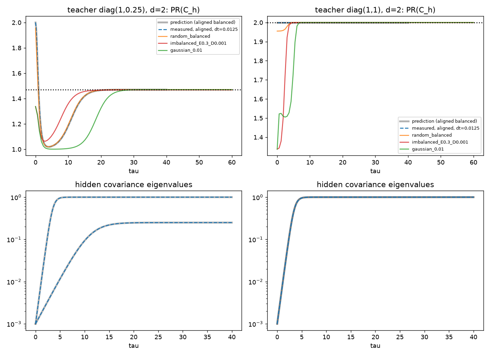

# Batch 1: balanced two-layer linear learning (Gate B)

Gate B passes. A two-layer linear network trained on exactly whitened belief coordinates follows the closed-form balanced trajectory $a_i(\tau)=s_i/(1+[s_i/a_i(0)-1]e^{-2s_i\tau})$. The maximum error in the measured hidden-covariance eigenvalues halves with each halving of the Euler step (0.061, 0.030, 0.015, 0.0076 for dt = 0.1 to 0.0125), as expected for first-order convergence to the continuous-time prediction. The endpoint PR matches the minimum-norm prediction $(\sum s_i)^2/\sum s_i^2$ to within 0.02% whenever the initialization is balanced or small. Deliberately imbalanced initialization departs from it by up to 17% (PR 1.72 against 1.47), which places that condition outside the theory's regime rather than refuting it (plan §6). This is a squared-loss benchmark on given belief coordinates, not a transformer result.

*Top: PR of the measured hidden covariance against training time for the teacher diag(1, 0.25), left, and diag(1, 1), right. The thick grey line is the closed-form prediction for aligned balanced initialization, and the dotted line is the minimum-norm endpoint. Bottom: the two hidden eigenvalues, measured (dashed) over predicted (grey). One initialization per curve.*

The prediction contains no fitted quantity. It uses only the teacher's singular values, the initial amplitude $a_0=10^{-3}$, and the time convention τ = learning rate × steps. With an anisotropic teacher, PR is nonmonotone: it drops from 2 toward 1 while the strong mode grows, then rises to 1.47 as the weak mode catches up, and the closed form reproduces this whole path, not only the endpoint.

## Setup

Inputs are the belief magnetizations $m=(m_1,m_2)$ of all 4,096 contexts of the T = 6 two-factor generator ($q_2=0.25$), whitened with their exact probabilities so that $\mathbb E[zz^\top]=I$ to round-off. The network is $h=Ez$, $\hat y=Dh$, with loss $\tfrac12\sum_cp_c\|DEz_c-Mz_c\|^2$, trained by Euler steps on gradients computed from the data. The hidden covariance is measured from activations, $C_h=\operatorname{Cov}_c(Ez_c)$, as an experiment would measure it. Teachers are diag(1, 0.25) and diag(1, 1), with hidden width d ∈ {2, 8}. Source: [`run.py`](run.py), results in [`results.json`](results.json); it runs in under a minute on the coordinator CPU.

## Endpoint PR by initialization (teacher diag(1, 0.25); τ = 60 and three seeds, except the aligned row: one initialization at τ = 40 and four Euler steps)

| Initialization | d = 2 | d = 8 | Prediction |
| --- | --- | --- | --- |
| Aligned balanced, $a_0=10^{-3}$ | 1.47059 (all dt) | 1.47059 | 1.47059 |
| Random balanced, scale 0.03 | 1.47059, 1.47059, 1.47059 | 1.47059, 1.47059, 1.47058 | 1.47059 |
| Random balanced + factor penalty λ = 0.1 | 1.32432 ×3 | 1.32432 ×3 | 1.32432, from spectrum $(s-\lambda)_+=(0.9,0.15)$ |
| Small Gaussian, std 0.01 (not balanced) | 1.47059, 1.47062, 1.47055 | 1.47030, 1.47042, 1.47082 | 1.47059 |
| Imbalanced: E std 0.3/√2, D std 10⁻³ | 1.4677, 1.5294, 1.5070 | 1.4924, 1.6210, 1.7155 | 1.47059 (outside regime) |

With teacher diag(1, 1) every balanced or small initialization ends at PR 2.0000, and the imbalanced one at 1.9921–1.9996. For imbalanced initialization the conserved imbalance $\|EE^\top-D^\top D\|_F$ stays at 0.08–0.12 (d = 2) and 0.31–0.58 (d = 8) through training, and that leftover covariance is what moves PR.

## How it was checked

- **Independent fact-check of this write-up** against `results.json` and `run.py`: all headline numbers held. It corrected the table heading (the aligned row is one initialization at τ = 40), softened "equals" to "matches to within 0.02%", fixed a rounded range, and removed an unmeasured claim about null-space directions.

- The test suite (`tests/test_linear.py`) checks the same trajectory with RK4 to $10^{-8}$, conservation of exact balance to $10^{-12}$, first-order Euler convergence, the $(s-\lambda)_+$ endpoint, and the uniform rescaling of the hidden spectrum by $\sqrt{\eta_E/\eta_D}$ under unequal layer rates, which leaves PR unchanged.
- Whitening is verified inside the script with an assertion.

## Not yet checked

- **Unwhitened inputs.** Plan §6 says to use them only after deriving the changed dynamics, which was not done.
- **Adam or cross-entropy versions of the benchmark.** The derivations warn that neither is covered by the balanced theorem.
