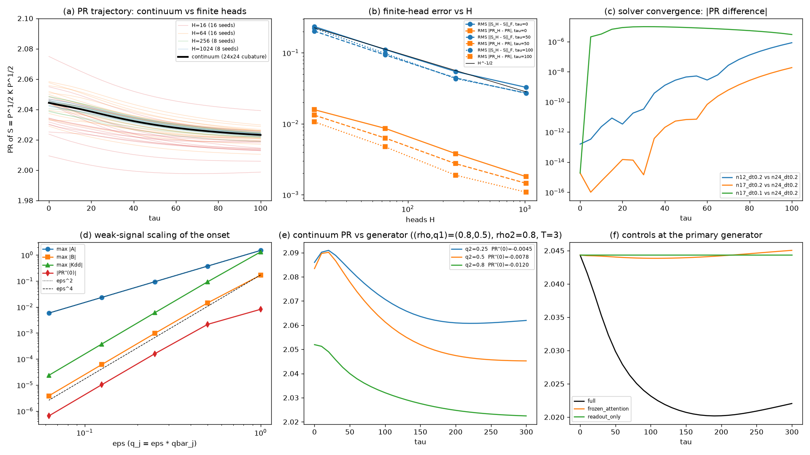

# Package 5: the many-head continuum predicts finite networks, with the predicted H^{-1/2} error

The deterministic continuum solution of the restricted many-head transformer (derivations §5.1–5.8) predicts the training-time representation spectrum of independently initialized finite networks. The RMS error of the centered kernel matrix falls as $H^{-0.48}$ to $H^{-0.51}$ (seed-bootstrap 95% intervals about ±0.12), and the RMS error of PR as $H^{-0.53}$ to $H^{-0.56}$ (about ±0.14), over H = 16 to 1,024 heads at τ = 0, 50 and 100. This is consistent with the $H^{-1/2}$ derived in §5.11. Between H = 256 and 1,024 alone, the kernel-error slope is shallower (−0.34 to −0.37). Training lowers PR from 2.0443 to 2.0232 by τ = 100, a change 20× the RMS finite-network error at H = 1,024 (0.0011). The change comes from attention learning: with β and κ frozen, PR stays within 0.001 of its initial value. These are checks of a solved restricted model against finite networks of the same model, not evidence about a dense GPT block.

*(a) PR of $S=P^{1/2}KP^{1/2}$ against training time τ for the continuum (black) and for finite networks with H = 16, 64 (16 seeds each), 256 and 1,024 (8 seeds each). (b) RMS errors of the kernel matrix and of PR against H at three times, with an $H^{-1/2}$ guide. (c) Solver convergence: PR differences between cubature orders 12², 17², 24² and between steps 0.2 and 0.1. (d) Onset coefficients under weak-signal scaling $q_j=\varepsilon\bar q_j$, with ε² and ε⁴ guides. (e) Continuum PR for three generators. (f) Controls: all parameters training, attention frozen, readout only.*

## Setup

The model is that of derivations §5.1. Each head has $(a_1,a_2,\beta,\kappa,g)$, a content-plus-position attention score $\beta t_s+\kappa d_s(c)$, a residual tanh MLP with gain $g$, and a mean readout over heads. Training is full-batch mean-field gradient flow on the exact population cross-entropy over all 64 contexts of length T = 3, using generator $(\rho_1,q_1)=(0.7,0.4)$, $(\rho_2,q_2)=(0.8,0.8)$ (the derivations' numerical-check generator) unless stated. The initial law is $a=0$, $g=1$, $(\beta,\kappa)\sim U([-1,1]\times[-\tfrac12,\tfrac12])$. The continuum uses tensor Gauss–Legendre cubature over $(\beta,\kappa)$. Finite networks draw H iid heads from the same law with weight 1/H. Integration is RK4 with step 0.2 to τ = 100 (300 for the sweep and controls). The continuum is computed independently of the finite networks, and nothing is fitted. Source: [`run.py`](run.py), results in [`results/`](results/), figure by [`plot.py`](plot.py), about 20 min on the coordinator CPU.

## Results

**Onset (derivations' numerical check).** PR(0) = 2.044328397168 and $\ddot{\mathrm{PR}}(0)=-0.008109884767$ at cubature orders 17² and 33². All twelve digits of the derivations' table are reproduced at every order, 5², 9², 17² and 33² ([`results/onset.json`](results/onset.json)). The test suite checks this to $10^{-11}$, and it also checks the coefficient against symmetric short-time integration with second-order convergence.

**Weak-signal scaling.** Scaling both reliabilities by ε = 1, ½, ¼, ⅛ and 1/16, max|A| falls 4.0× per halving, and max|B|, max|$\ddot K(0)$| and |$\ddot{\mathrm{PR}}(0)$| fall by a ratio that approaches 16× per halving as ε shrinks: 11.6×, 14.0× and 3.8× from ε = 1 to ½, and 15.9×, 16.0× and 15.9× from ⅛ to 1/16. This is the asymptotic scaling §5.9 predicts, $A=O(\varepsilon^2)$ and $B,\ddot K=O(\varepsilon^4)$.

**Solver accuracy.** Cubature error is below $2\times10^{-8}$ in PR at 17² and below $10^{-6}$ at 12², relative to 24². Halving the step changes PR by at most $1\times10^{-5}$. Both are 100× or more below the H = 1,024 finite-network error, so the numerical continuum is not the limiting factor.

**Finite-H approach.** RMS kernel error (Frobenius) is 0.234, 0.111, 0.054 and 0.033 at τ = 0, and 0.221, 0.098, 0.043 and 0.027 at τ = 100, for H = 16, 64, 256 and 1,024. The corresponding RMS PR errors are 0.0158, 0.0086, 0.0038 and 0.0018 at τ = 0, and 0.0106, 0.0047, 0.0019 and 0.0011 at τ = 100. The mean signed PR error at τ = 100 is −0.006 at H = 16 and under 0.0007 in magnitude for H ≥ 64, so no finite-H bias is visible beyond H = 16 at these seed counts. The derivation does not establish a bias rate either way.

**Generator dependence (T = 3, $(\rho_1,q_1)=(0.8,0.5)$, $\rho_2=0.8$).** Initial PR is 2.0860, 2.0834 and 2.0519 and the onset coefficient $\ddot{\mathrm{PR}}(0)$ is −0.0045, −0.0078 and −0.0120 for $q_2$ = 0.25, 0.5 and 0.8. By τ = 300 the continuum PR has fallen to 2.062 (minimum 2.0607 at τ = 220), 2.045 and 2.022. PR is nonmonotone at $q_2$ = 0.25 and 0.5: despite the negative onset coefficient it rises to about 2.09 by τ ≈ 20 and then falls. So the τ² onset describes only a short initial window for these generators. Which parameters drive the rise and the later decrease was not tested for them; the controls below were run only on the primary generator.

**Controls (primary generator, to τ = 300).** Readout-only training leaves PR exactly at 2.04433, as it must, because the measured residual does not depend on the readout. Frozen attention (readout and MLP gain $g$ train) moves PR by at most 0.0007 (2.0438–2.0450). Full training lowers PR to 2.0202 at τ ≈ 190 and to 2.0220 by τ = 300. The final losses are 1.21895, 1.21844 and 1.21765 nats, so attention learning buys both the lower loss and the change in representation geometry.

## Dependent generators: the interaction extension (derivations §5.14, plan §4.2)

[`coupled.py`](coupled.py) runs the continuum (17² cubature, T = 3, τ = 300) on the coupled generator $P_\varepsilon=(1-\varepsilon)P_1\otimes P_2+\varepsilon P_{\mathrm{corr}}$ (c = 0.8, ρ = 0.8, $q_1=q_2=0.5$), with and without the interaction logit $y_1y_2f_{12}$ (b(0) = 0). Results are in [`results/coupled.json`](results/coupled.json). The factorization gap is the smallest excess loss any factorized predictor can reach, $\mathbb E_c\,\mathrm{KL}(P\,\|\,P_1P_2)$, computed exactly at T = 3.

| ε | factorization gap (nats) | excess loss, factorized model | excess loss, with interaction | PR(S), factorized | PR(S), with interaction |
| --- | --- | --- | --- | --- | --- |
| 0 | 0 | 0.00039 | 0.00084 | 2.045 | 2.094 |
| 0.05 | 0.00017 | 0.00048 | 0.00087 | 2.054 | 2.108 |
| 0.2 | 0.00228 | 0.00295 | 0.00099 | 2.071 | 2.111 |

At ε = 0.2 the interaction model is ahead from τ = 10 on, and ends below the factorization gap. So it has learned interaction content that no factorized predictor could use. At ε = 0 and 0.05 it is still behind the factorized model at τ = 300: the gap to win is zero or smaller than both models' remaining optimization error, and the extra interaction gradient slows the shared head parameters. The residual PR is higher with the interaction logit **in every case, including the independent generator** (2.094 against 2.045 at ε = 0). A PR increase therefore does not by itself identify interaction content, which is the warning in plan §4.2. Here the higher PR comes from how the interaction gradient reshapes the shared attention and MLP parameters, not from anything the generator requires. These are single continuum trajectories at one horizon. Longer horizons and finite-H checks were not run.

## How it was checked

- **Independent fact-check of this write-up** against `results/*.json`: all headline numbers held. It added seed-bootstrap intervals for the H exponents, corrected the weak-signal ratios (16× is reached only as ε shrinks), and removed an untested attribution of the sweep generators' PR phases to readout and attention learning.

- Analytic head gradients equal −H times the autograd gradient of an independent torch implementation of the same model, to $10^{-12}$ (`tests/test_heads.py`). So do the §5.14 interaction-extension gradients.
- The loss decreases monotonically along the flow, as §5.6 requires.
- The onset coefficient agrees with symmetric short-time integration ±τ, with the second-order error ratio expected from differencing.

## Not yet checked

- **Longer horizons.** §5.11's constants can grow with τ, and only τ ≤ 100 was compared against finite networks. Rerunning `finite` with `TAU = 300` would take about 1 hour of CPU.
- **The candidate Gaussian fluctuation theory (§5.12).** It predicts the PR variance across seeds at each H, and comparing it with the seed spread in panel (a) would test it. It is not implemented.
- **Transfer to the dense transformer.** The connection to Batch 2's dense transformer is untested. This model fixes the value features and has no cross-head mixing.
