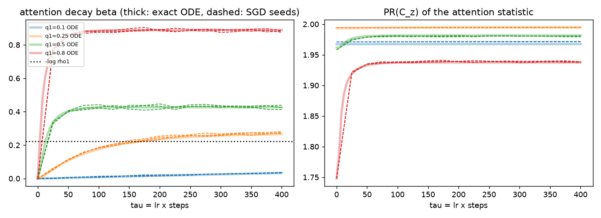

# Stage C: a learned positional attention filter follows its exact learning ODE

For the restricted attention model of derivations §3.3, a single trainable positional decay β with a linear readout over fixed token features, the gradient-flow ODE computed from exact generator sums predicts what minibatch SGD on sampled data learns. At τ = 400 the predicted decay is β = 0.427 and 0.888 for factor-1 reliability $q_1$ = 0.5 and 0.8, against 0.425 ± 0.011 and 0.881 ± 0.005 for SGD (mean ± SD over 3 seeds). The predicted PR of the attention statistic's covariance, 1.9815 and 1.9375, matches SGD's 1.980 and 1.938. At low reliability the prediction is systematically a little low: $q_1$ = 0.25 gives 0.265 against 0.276 ± 0.004, and $q_1$ = 0.1 gives 0.033 against 0.036 ± 0.002. This is the plan's "independent trained-filter prediction" for Gate C, in a deliberately restricted model with fixed value/output geometry, so it says nothing yet about unrestricted attention.

*Left: learned decay β against τ = learning rate × steps. Thick lines are the exact ODE and dashed lines are the 3 SGD seeds per reliability. The dotted line is the weak-signal value −log ρ1 = 0.223. Right: PR of the attention statistic's covariance, $C_z(\beta)$.*

## Setup

The generator is the two-factor process with $\rho_1=0.8$, $\rho_2=0.5$, $q_2=0.5$, $q_1\in\{0.1,0.25,0.5,0.8\}$ and context length T = 6. The model is $z(c;\beta)=\sum_k\operatorname{softmax}_k(-\beta k)\,\phi(x_{T-k})$ with $\phi(x)=(x_1,x_2)$, both factor signs, held fixed, and output $f=w^\top z$. The target is factor 1's next sign. Both runs start at $w=0$, $\beta=0$.

- **Prediction.** RK4 integration (step 0.5) of $\dot w=-\sum_cp_ce_cz(c)$, $\dot\beta=-\sum_cp_ce_cw^\top z_\beta(c)$ over all 4,096 contexts, with exact target $y(c)=\rho_1q_1m_1(c)$. Nothing from the SGD runs enters it.
- **Test.** SGD with learning rate 0.05, batch 256, fresh sampled contexts, and the actual next sign as target. That target has the same conditional mean, so the expected gradient is the same. Runs last 8,000 steps (τ = 400). Covariances come from 20,000 sampled evaluation contexts, the same set for all seeds.

Source: [`run.py`](run.py), results in [`results.json`](results.json), about 4 min on the coordinator CPU.

## Results at τ = 400

| $q_1$ | β, ODE | β, SGD (3 seeds) | $w_1$, ODE | $w_1$, SGD mean | PR($C_z$), ODE | PR($C_z$), SGD |
| --- | --- | --- | --- | --- | --- | --- |
| 0.10 | 0.0328 | 0.0376, 0.0336, 0.0354 | 0.029 | 0.037 | 1.9674 | 1.9714 ×3 |
| 0.25 | 0.2653 | 0.2804, 0.2755, 0.2706 | 0.155 | 0.168 | 1.9946 | 1.9947 ×3 |
| 0.50 | 0.4265 | 0.4123, 0.4391, 0.4229 | 0.420 | 0.428 | 1.9815 | 1.979–1.981 |
| 0.80 | 0.8884 | 0.8747, 0.8856, 0.8833 | 0.659 | 0.664 | 1.9375 | 1.937–1.939 |

The learned decay is generator-dependent and far from the weak-signal value −log ρ1 = 0.223 at the primary reliabilities: β is 0.43 at $q_1$ = 0.5 and 0.89 at 0.8. At $q_1$ = 0.1 learning is still slow at τ = 400, so β has not reached its weak-signal optimum. The readout weight on factor 2's feature stays at 0 in the ODE and within ±0.006 in SGD, because that feature does not predict the target. Factor 2's feature still enters $C_z$ as unpredictive variance, which keeps PR near 2. The PR change from training is small, 1.748 → 1.938 at $q_1$ = 0.8 and 1.962 → 1.982 at 0.5. It comes from β reweighting the two features' temporal correlations, not from the readout.

## How it was checked

- Finite-difference checks of $\partial_\beta\alpha$ and $\partial_\beta^2\alpha$, a monotone loss decrease along the ODE, and agreement of the recorded covariance with a direct recomputation are all in `tests/test_attention_filter.py`.
- The ODE and SGD start from the same point and use the same time convention, τ = learning rate × steps.

## Not yet checked, and caveats

- **SGD's β at low reliability.** SGD ends above the ODE in every seed at $q_1$ = 0.1 and 0.25 (by 2–15% per seed; 8% and 4% for the seed means), more than the seed spread at 0.25. A finite learning rate (0.05) or the sampled-target noise could cause this. Halving the learning rate would separate the two, about 10 min of CPU.
- **The PR difference at $q_1$ = 0.1.** SGD's 1.9714 against the ODE's 1.9674 is identical across seeds because all seeds share one 20,000-context evaluation set. It is an evaluation-sample difference, not a training effect. Evaluating on the exact population would remove it.
- **Value/output geometry and content-dependent scores.** Both stay fixed here. Releasing them is steps 3–4 of the derivation ladder in roadmap §6.2.
