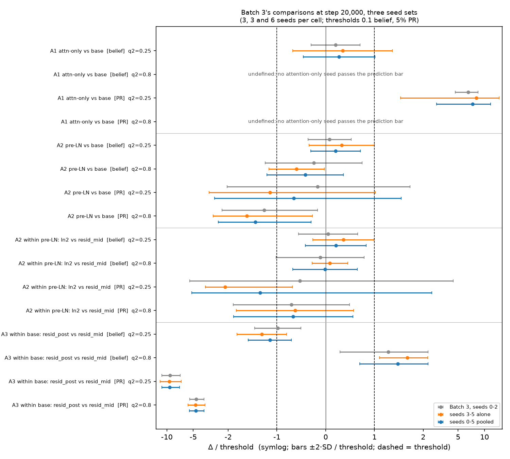

# Batch 3b: Batch 3's ablation verdicts hold on six seeds

All eight of Batch 3's verdicts are unchanged when graded on seeds 0–5 pooled, so by the definition's rule every one is robust. The five that sat near their limits moved away from them. The MLP stage's effect on the belief metric now clears the 0.1 threshold in both conditions: the factor-1 share moves by +0.148 at q2 = 0.8 (2·SD 0.078) and by −0.114 at q2 = 0.25 (2·SD 0.044), against +0.129 and −0.098 on three seeds. The attention-only comparison's prediction-quality ratio fell from 1.995 to 1.936, against a cap of 2. Graded on seeds 3–5 alone, seven of the eight verdicts agree with Batch 3. The exception is the within-pre-LN PR comparison, which is supported on the new seeds but inconclusive on the original three and on all six, so the pooled verdict stays inconclusive. The attention-only model again misses the prediction-quality bar at q2 = 0.8 in all three new seeds.

The pre-registered design is in [EXPERIMENT.md](EXPERIMENT.md), Batch 3's write-up in [../transformer-ablations/README.md](../transformer-ablations/README.md). The numbers below come from [`grades_seeds0-5.json`](grades_seeds0-5.json) and [`grades_seeds3-5.json`](grades_seeds3-5.json) (readable versions in the `.txt` files next to them). Both were produced by [`grade.py`](grade.py), which is Batch 3's grader with the seed list made a parameter, applied to [`results_combined.json`](results_combined.json) (Batch 3's committed `results.json` plus this run's [`results.json`](results.json)).

## Verdicts

Each comparison has two verdicts. The **belief metric** is the factor-1 share of the normalized belief block after token identity is partialled out, in the m or u coordinates (whichever has the larger |Δ|), with an absolute threshold of 0.1. **PR(C_h)** is the participation ratio of the full covariance of the final-position activation, with a threshold of 5% of the second-named cell. Δ = first cell − second cell, as seed means at step 20,000 over runs that pass the prediction-quality bar. SD is the larger of the two cells' sample SDs over seeds. A comparison is supported if, in at least one condition, |Δ| exceeds the threshold, 2·SD and the step-0 |Δ|, with the two cells' prediction errors within a factor of 2. It is not supported if, in both conditions, |Δ| and 2·SD are both below the threshold, and it is inconclusive otherwise.

| Comparison | Metric | Batch 3 (seeds 0–2) | **Seeds 0–5 pooled** | Seeds 3–5 alone | Robust? |
|---|---|---|---|---|---|
| A1: attention-only vs baseline, at `resid_post` | belief | inconclusive | **inconclusive** | inconclusive | yes |
| | PR | supported | **supported** | supported | yes |
| A2: pre-LN vs baseline, at `resid_post` | belief | not supported | **not supported** | not supported | yes |
| | PR | supported | **supported** | supported | yes |
| A2 within pre-LN: `ln2` vs `resid_mid` | belief | not supported | **not supported** | not supported | yes |
| | PR | inconclusive | **inconclusive** | supported | yes |
| A3 within baseline: `resid_post` vs `resid_mid` | belief | supported | **supported** | supported | yes |
| | PR | supported | **supported** | supported | yes |

The sites are positions in the one-layer block: `resid_mid` is the residual after attention, `ln2` the LayerNorm output that feeds the MLP in the pre-LN model, and `resid_post` the residual after the MLP, which the readout sees. The attention-only model has no MLP, the pre-LN model normalizes branch inputs only and has no final LayerNorm, and q2 is the second hidden factor's emission parameter, with two conditions, 0.25 and 0.8.

*Every graded comparison at step 20,000, as Δ / threshold with ±2·SD / threshold bars, for Batch 3's seeds 0–2 (grey, 3 seeds per cell), the new seeds 3–5 (orange, 3 per cell) and all six pooled (blue, 6 per cell). The dashed lines are the thresholds. A size pass needs the point outside them and the bar clear of 0; a null pass needs the point inside them and the bar no longer than 1 on each side. The step-0 and prediction-quality conditions aren't drawn. The x-axis is linear within ±2 and logarithmic beyond. Plotted by [`plot.py`](plot.py).*

## The five verdicts near their limits

Batch 3's supervisor named five verdicts that more seeds could flip. Each one moved away from its limit on six seeds.

| Verdict | Quantity at its limit | Batch 3 (3 seeds) | Seeds 0–5 (6 seeds) | Seeds 3–5 (3 seeds) |
|---|---|---|---|---|
| A3 belief, supported | q2 = 0.8: Δ against 2·SD (threshold 0.1) | +0.129 vs 0.100 | +0.148 vs 0.078 | +0.168 vs 0.057 |
| | q2 = 0.25: Δ against threshold 0.1 | −0.098 | −0.114 (2·SD 0.044) | −0.131 (2·SD 0.051) |
| A2 PR, supported | q2 = 0.8: Δ against 2·SD (threshold 0.120) | −0.150 vs 0.131 | −0.173 vs 0.137 | −0.196 vs 0.163 |
| A1 PR, supported | excess-KL ratio against cap 2 | 1.995 | 1.936 | 1.884 |
| A2 belief, not supported | larger 2·SD against threshold 0.1 | 0.0995 | 0.078 | 0.067 |
| A2-within-pre-LN belief, not supported | larger 2·SD against threshold 0.1 | 0.090 | 0.066 | 0.063 |

For A3's belief verdict, Batch 3 rested on q2 = 0.8 alone, and at q2 = 0.25 Δ sat just under the threshold with the opposite sign. On six seeds it clears the threshold in both conditions, in opposite directions: the MLP stage raises the factor-1 share at q2 = 0.8 (0.308 at `resid_mid` to 0.456 at `resid_post`) and lowers it at q2 = 0.25 (0.634 to 0.519). The per-seed paired differences have the same sign in all six seeds in each condition. At q2 = 0.8 they are +0.13, +0.19, +0.07, +0.20, +0.18 and +0.12 for seeds 0–5, so seed 2 is still the only one below 0.1. At q2 = 0.25 they run from −0.06 (seed 1) to −0.14. The u coordinate agrees in sign in both conditions (+0.141 and −0.088).

For A2's PR verdict, pre-LN lowers PR(C_h) at `resid_post` from 2.402 to 2.230 at q2 = 0.8, the paired differences are negative in all six seeds (−0.08 to −0.33), and the step-0 Δ is −0.052. At q2 = 0.25 it still doesn't pass (Δ −0.066, 2·SD 0.224).

For A1's PR verdict, the attention-only model's PR at q2 = 0.25 is 2.771 against the baseline's 2.030 (Δ +0.741, threshold 0.10, 2·SD 0.45, step-0 Δ +0.008). Every one of the six paired differences is positive, from +0.41 to +1.06. Seeds 3–5 spread the attention-only model's PR much more widely (2.46 to 3.07, against 2.63 to 2.77 for seeds 0–2), and since 2·SD is set by the more variable cell, it rose from 0.19 to 0.45. The ratio of the two cells' prediction errors fell to 1.936 because the attention-only model's mean error rose proportionally less than the baseline's (4% against 7%; table below).

## The one disagreement: PR within pre-LN

On seeds 3–5 alone, PR(C_h) falls from `resid_mid` to `ln2` by 0.414 at q2 = 0.25 (3.825 to 3.411; threshold 0.191, 2·SD 0.283, step-0 Δ +0.008), which passes. On seeds 0–2 the same Δ was −0.10 with 2·SD 0.96, and pooled it is −0.259 with 2·SD 0.742. The per-seed differences at q2 = 0.25 are −0.54, +0.14 and +0.08 for seeds 0–2 and −0.35, −0.64 and −0.26 for seeds 3–5. Four of six seeds fall by more than the threshold and two rise slightly, and the pooled SD is large enough that the six-seed verdict stays inconclusive. At q2 = 0.8 the fall is −0.115 pooled, under its threshold of 0.173 in every seed set. The new seeds alone would say LayerNorm before the MLP lowers PR at q2 = 0.25, but the pooled data doesn't support that claim under the pre-registered rule.

## Prediction quality

A run passes the bar if its final-position KL(Bayes‖model), averaged over the last quarter of evaluations (steps 14,750–20,000), is below the KL of the best predictor that sees only the last four tokens.

| Architecture | q2 | tail-mean KL, seeds 0–2 | seeds 3–5 | 4-token floor | passing, seeds 3–5 |
|---|---|---|---|---|---|
| baseline | 0.25 | 0.00057 (0.00054–0.00060) | 0.00065 (0.00056–0.00071) | 0.00144 | 3/3 |
| baseline | 0.8 | 0.00102 (0.00094–0.00112) | 0.00105 (0.00094–0.00110) | 0.00132 | 3/3 |
| attention-only | 0.25 | 0.00115 (0.00109–0.00121) | 0.00123 (0.00119–0.00131) | 0.00144 | 3/3 |
| attention-only | 0.8 | 0.00259 (0.00246–0.00269) | 0.00257 (0.00251–0.00263) | 0.00132 | **0/3** |
| pre-LN | 0.25 | 0.00058 (0.00056–0.00059) | 0.00060 (0.00054–0.00063) | 0.00144 | 3/3 |
| pre-LN | 0.8 | 0.00102 (0.00097–0.00111) | 0.00098 (0.00091–0.00105) | 0.00132 | 3/3 |

Values are seed means with the range over seeds. The attention-only model misses the bar at q2 = 0.8 in all six seeds now, at about twice the 4-token floor, so A1 stays undefined at q2 = 0.8 for both metrics and its belief verdict stays inconclusive. Every other run passes. The new seeds' errors fall within or near the old seeds' ranges, except that the baseline at q2 = 0.25 is higher on seeds 3–5 (mean 0.00065, against 0.00054–0.00060 on seeds 0–2), which is what lowered A1's KL ratio.

## How it was done

The 18 new runs are an exact rerun of Batch 3's design with seeds 3, 4 and 5: the same one-layer transformer (d = 64, two heads, a GELU MLP of width 256), three architectures (baseline, attention-only, pre-LN), q2 ∈ {0.25, 0.8}, Adam at lr 1e-3 (the rate Batch 3's pilots selected for all three architectures; the pilots were not rerun), batch 256, 20,000 steps of online data. Every one of the 15 checkpoints per run was analyzed at the final position on 65,536 held-out sequences, and [`run.sh`](run.sh) then summarized, combined and graded the results in one pass. The controls are Batch 3's: step-0 checkpoints, the token-identity partialling with its R² gate of 0.01, the 4-token KL floor as the prediction bar, the excess-KL ratio cap and per-architecture learning rates.

## How it was checked

- **The grader reproduces Batch 3.** Rerunning `grade.py` on Batch 3's `results.json` with seeds 0–2 gives a `grades.json` identical to Batch 3's committed one, and rerunning it on `results_combined.json` with seeds 0–5 reproduces `grades_seeds0-5.json` byte for byte.
- **Completeness.** `results.json` holds 270 records, 18 runs × 15 checkpoints, and all losses are finite. All 18 runs finished with analysis at step 20,000, against the success criterion of at least 16. The combined file holds Batch 3's 288 records plus these 270.
- **Partialling invariant.** The token-partialled factor-1 share at `attn_out` and `resid_mid` agrees to 2e-9 in every new record, as it must, because the residual add contributes only token identity at the final position. In the attention-only runs `resid_mid` and `resid_post` have identical PR.
- **Step-0 condition.** At step 0 the belief R² gain at the graded sites is at most 0.0040, below the 0.01 gate, so the step-0 belief Δ is undefined for every comparison, as in Batch 3. Step-0 PR differences are at most 0.058 in absolute value.
- **Fact-check.** A fact-checker agent compared about 100 claims here against the grades files, `results.json`, the run directories, the worker's records and Batch 3's files, and reran `grade.py` to reproduce all three grades files. It corrected six claims, none of which changed a verdict: a Δ misrounded as −0.115 (it is −0.114); the explanation for A1's larger 2·SD, which the first version attributed to the paired differences when it comes from the attention-only cell's spread; the KL ratio's fall, which comes from a smaller proportional (not absolute) rise in the attention-only error; the claim that the new seeds' errors all sit near the old ranges, which missed the baseline's higher error at q2 = 0.25; the statement that pre-LN "leaves the belief metric unchanged", which overstated a null; and the end time (00:47, not 00:48).
- **Gate for u.** The definition gates u on the m gain. Gating u on its own gain would change one gate decision among the new records, at `mlp_out` at step 100 in one run, which no verdict reads.

## Not yet checked

- **Whether the within-pre-LN PR effect at q2 = 0.25 is real.** Four of six seeds show a fall larger than the threshold and two a small rise. More seeds, or a look at what distinguishes seeds 0–2's spread, would decide it. Three more seeds would cost about $0.80 and 80 minutes on an A40 at this run's pace. No headline claim depends on it, since the verdict here is inconclusive.
- **Whether attention-only reaches the bar at q2 = 0.8 with longer training,** which would make A1 gradable there. That needs a different design, since training length is fixed.
- **A pre-LN model with a final LayerNorm**, the standard architecture, which neither batch tested.

## Judgement calls

No new ones. The grading rules, thresholds, SD convention (sample SD, ddof = 1, larger of the two cells) and reference cell for the PR threshold are Batch 3's, applied unchanged; its write-up lists the alternatives. Pooling seeds 0–5 into one cell per architecture and condition, instead of, say, averaging the two three-seed verdicts, is what the definition specifies. Larger samples make the sample SD more stable, but they don't shrink it systematically, so the six-seed grading is not easier to pass by construction: A1's 2·SD rose from 0.19 to 0.45.

## What this means

Batch 3's conclusion that the MLP stage is where the final-position geometry changes now rests on six seeds, with every verdict unchanged. The belief-metric part of it is firmer than before: the MLP stage moves the factor-1 share past the threshold in both conditions, in opposite directions, which a theory of that stage will have to explain. Pre-LN normalization of branch inputs changes the belief metric by less than the 0.1 threshold (|Δ| ≤ 0.042 on six seeds) and lowers PR(C_h) by about 7% at q2 = 0.8 only. The prediction-quality caveat on A1 is smaller (ratio 1.936) but still present, since the attention-only model is about twice as far from Bayes as the baseline at q2 = 0.25. The next steps Batch 3 named still stand: a constrained-update calculation for the MLP stage, and a longer attention-only run if A1 at q2 = 0.8 matters.

## Run record

One NVIDIA A40 (CA-MTL-1, $0.59/h) ran from 23:26 on 2026-11-15 to 00:47 UTC on 2026-11-16, 1 h 21 min including setup, about $0.80 against an $8 budget and a 3 h cap. Training all 18 runs took about 14 minutes (4 at a time), and the serial analysis took about 65 minutes. Code: commit `4f590ba`. Logs are in [`logs/`](logs/), and the per-run configs, metrics and analysis files are in `runs/transformer-ablations-seeds/`.
