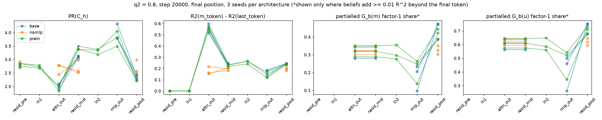

# Batch 3: where in the block the belief geometry changes

In the one-layer transformer of the experiment plan (§8.1), the MLP stage is where the final-position geometry changes after attention writes it. Pre-LayerNorm moves the token-partialled belief metric by less than 0.03 and lowers PR of the full covariance by 6% at q2 = 0.8 only. Within the baseline model, the MLP lowers PR of the full activation covariance from 3.78 ± 0.21 to 2.04 ± 0.10 at q2 = 0.25 and from 3.10 ± 0.04 to 2.39 ± 0.07 at q2 = 0.8 (3 seeds each). That PR result is robust, clearing its threshold by more than 4× in both conditions. The belief-metric results are much closer to their limits. The MLP moves the belief metric's factor-1 share by +0.13 at q2 = 0.8 against a pre-registered threshold of 0.1, and by −0.10 at q2 = 0.25, just under it. The pre-LN null on the belief metric passes its seed-noise test at 2·SD = 0.0995 against 0.1. The attention-only model fails the prediction-quality bar at q2 = 0.8, so its belief-metric comparison is inconclusive, and its PR comparison passed the prediction-quality match at a ratio of 1.995 against a cap of 2. The verdicts at their limits are listed under "Not yet checked".

The experiment's definition, with the pre-registered rules, is [EXPERIMENT.md](EXPERIMENT.md). The numbers below come from [`results.json`](results.json), graded by [`grade.py`](grade.py) (output in [`grades.json`](grades.json)), and the full per-site tables are in [`tables.md`](tables.md).

## Verdicts

Each comparison gets two verdicts, one for the **belief metric** (the factor-1 share of the normalized belief block E_bᵀE_b after token identity is partialled out, in m and in u coordinates, threshold 0.1) and one for **PR(C_h)**, the participation ratio of the full covariance of the final-position activation (threshold 5% relative). All values are at step 20,000, seed means over runs that pass the prediction-quality bar, with Δ = first cell − second cell and SD the larger of the two cells' sample SDs over seeds. "Step-0 Δ" is the same difference at initialization. The belief metric is undefined at step 0 at every graded site (see "How it was checked").

| Comparison | Belief metric | PR(C_h) |
|---|---|---|
| A1: attention-only vs baseline, at `resid_post` | **inconclusive.** Δ = +0.020 (2·SD 0.050) at q2 = 0.25; undefined at q2 = 0.8 because no attention-only seed passes the bar | **supported**, at the edge of matched quality. Δ = +0.66 (2.70 vs 2.04, threshold 0.10, 2·SD 0.19, step-0 Δ +0.011) at q2 = 0.25; excess-KL ratio 1.995 against the cap of 2 |
| A2: pre-LN vs baseline, at `resid_post` | **not supported**, narrowly. Δ = +0.008 (q2 = 0.25) and −0.025 (q2 = 0.8); 2·SD is 0.044 and 0.0995 against the 0.1 threshold | **supported** at q2 = 0.8 only. Δ = −0.150 (2.24 vs 2.39, threshold 0.119, 2·SD 0.131, step-0 Δ −0.046); Δ = −0.017 at q2 = 0.25 (step-0 Δ −0.027) |
| A2: within pre-LN, `ln2` vs `resid_mid` | **not supported.** Δ = +0.005 (q2 = 0.25) and −0.011 (q2 = 0.8, in u); 2·SD 0.061 and 0.090 | **inconclusive.** Δ = −0.10 and −0.12 (step-0 Δ −0.051 and −0.053), both under the thresholds, but at q2 = 0.25 one seed moves by −0.54 and 2·SD is 0.96 |
| A3: within baseline, `resid_post` vs `resid_mid` | **supported** at q2 = 0.8. Δ = +0.129 in m (2·SD 0.100); +0.123 in u. At q2 = 0.25 Δ = −0.098, just under the threshold and of opposite sign | **supported** in both conditions. Δ = −1.74 (q2 = 0.25) and −0.72 (q2 = 0.8), step-0 Δ −0.011 in both |

The sites are positions inside the block: `resid_pre` is the embedding, `attn_out` the attention output, `resid_mid` the residual after attention, `mlp_out` the MLP output, `resid_post` the residual after the MLP (what the readout sees), and in the pre-LN model `ln1` and `ln2` are the LayerNorm outputs that feed attention and the MLP. The pre-LN variant normalizes branch inputs only and has **no final LayerNorm before the readout**, unlike standard pre-LN transformers.

The definition asks for per-seed paired differences for A1 and A3 as a descriptive check. For the supported verdicts, every seed has the same sign as the unpaired Δ. In A1 at q2 = 0.25, PR(C_h) rises by 0.67, 0.69 and 0.64 in seeds 0, 1 and 2. In A3, PR falls by 1.54, 2.05 and 1.64 (q2 = 0.25) and by 0.73, 0.62 and 0.80 (q2 = 0.8). The m factor-1 share at q2 = 0.8 rises by 0.13, 0.19 and 0.07, so seed 2 alone sits below the 0.1 threshold. For A1's inconclusive belief comparison at q2 = 0.25 the paired differences (+0.040, −0.023, +0.044) don't share a sign.

*q2 = 0.8, step 20,000, 3 seeds per architecture, one line per seed. Panels, left to right: PR(C_h); the belief-specific R² gain R²(m_token) − R²(last_token), i.e. how much held-out variance beliefs explain beyond the final token; the gated factor-1 share in m; the same in u. The attention-only model (orange) has no MLP sites and misses the prediction-quality bar in all three seeds at this q2. The same figure for q2 = 0.25 is [figures/sites_q0.25.png](figures/sites_q0.25.png).*

Attention writes a belief block whose factor-1 share is the same at `attn_out` and `resid_mid`, because adding the embedding only adds token identity, which the metric partials out. At q2 = 0.8 the MLP output carries a differently shaped belief block (factor-1 share 0.18 in m, against 0.31 at `resid_mid`), and adding it moves the share at `resid_post` to 0.44. At q2 = 0.25 the MLP output's share (0.67) is close to `resid_mid`'s (0.63), and the share at `resid_post` falls to 0.53. LayerNorm before the MLP (`ln2`) changes the share by at most 0.011.

## How the MLP lowers PR (exploratory)

This was found after looking at the graded results, from one extra pass over `results.json`, so it is descriptive. Across the MLP stage of the baseline, the trace of C_h drops from 42.3 to 16.5 (q2 = 0.25) and from 58.5 to 27.4 (q2 = 0.8). Meanwhile the held-out R² of the activation on the belief coordinates m alone rises from 0.51 to 0.87 and from 0.71 to 0.88. Splitting the trace accordingly, the variance beliefs don't explain falls from about 21 to 2 (q2 = 0.25) and from 17 to 3 (q2 = 0.8), and the belief-explained part also falls, from about 21 to 14 and from 42 to 24. These numbers fit a reading in which the MLP output cancels most of the residual's non-belief variance along with part of the belief variance, which leaves the covariance concentrated in fewer directions. This pass did not test that reading. The attention-only model doesn't fit it simply. Its total variance at `resid_post` is already low (trace 15.4 at q2 = 0.25 and 31.1 at q2 = 0.8, about the baseline's after its MLP), yet its PR stays higher (2.70 vs 2.04 at q2 = 0.25) and its R²(m) lower (0.70 vs 0.87). So attention trained without an MLP downstream writes a smaller residual with a different shape, not the baseline's `resid_mid`. The pre-LN model behaves like the baseline (trace 49.7 → 17.7, R²(m) 0.47 → 0.86 at q2 = 0.25).

## Prediction quality

A main run passes the bar if its final-position KL(Bayes‖model) is below the KL of the best predictor that sees only the last four tokens. The KL is averaged over the last quarter of evaluations: `summarize.py` takes the last 22 of 89, steps 14,750–20,000, which is slightly wider than the definition's "15,000–20,000".

| Architecture | q2 | tail-mean KL, seed mean (range) | 4-token floor | passing seeds |
|---|---|---|---|---|
| baseline | 0.25 | 0.00058 (0.00054–0.00060) | 0.00144 | 3/3 |
| baseline | 0.8 | 0.00102 (0.00094–0.00112) | 0.00132 | 3/3 |
| attention-only | 0.25 | 0.00115 (0.00109–0.00121) | 0.00144 | 3/3 |
| attention-only | 0.8 | 0.00259 (0.00246–0.00269) | 0.00132 | **0/3** |
| pre-LN | 0.25 | 0.00058 (0.00056–0.00059) | 0.00144 | 3/3 |
| pre-LN | 0.8 | 0.00102 (0.00097–0.00111) | 0.00132 | 3/3 |

The attention-only model can't reach the bar at q2 = 0.8 in 20,000 steps. Its error is about twice the 4-token floor, though well below the 3-token floor of 0.0036. It is also about twice as far from Bayes as the baseline at q2 = 0.25, which is why the A1 PR verdict sits on the matching cap (0.0011469 / 0.0005750 = 1.995). Pre-LN and baseline predict equally well (ratio 1.01). Floors for k = 1–4 per run are in `tables.md`, table 1.

## How it was done

The model has one layer, d = 64, two attention heads of width 32, a GELU MLP of width 256, learned token and position embeddings and an untied readout. It is trained with Adam, batch 256, for 20,000 steps on online data from a generator with two independent binary hidden factors, (ρ1, q1) = (0.8, 0.5), ρ2 = 0.8, q2 ∈ {0.25, 0.8}, context length 16. There are three architectures (baseline, attention-only, pre-LN with affine LayerNorm), each at two conditions with seeds 0–2, so 18 main runs.

Each architecture got its own learning-rate pilot at q2 = 0.5 over {1e-4, 3e-4, 1e-3}, with the declared selection rule: the largest stable lr within 20% + 1e-4 nats of the best pilot's KL. All nine pilots were stable, and **all three architectures selected lr = 1e-3**. So the comparisons are at a shared lr, and the definition's lr-confound report, required only where selected lrs differ, does not apply.

Every checkpoint (15 per run, on a log schedule from step 0 to 20,000) was analyzed at the final position on 65,536 held-out sequences (eval seed 7). The belief metric is read only where beliefs add at least 0.01 held-out R² beyond the final token; elsewhere it is undefined. The controls were each model's step-0 checkpoint, the baseline arm trained under identical seeds and analysis, per-architecture lr selection, the short-window KL floors as the prediction bar, and the token-identity partialling with its R² gate.

## How it was checked

- **Grading code.** `grade.py` was written before the GPU results arrived. I first ran it on a 20-step CPU smoke run of the whole driver, whose outputs were kept only in the supervising session's scratch directory, not in the repository. There every run fails the bar, as it should after 20 steps, so I ran a copy with the bar and gate disabled and checked one verdict by hand. A fact-checker later reran `grade.py` on `results.json` and reproduced `grades.json` exactly.
- **Partialling invariant.** The token-partialled belief metric should be identical at `attn_out` and `resid_mid`, because the residual adds only the token and position embedding, which at the final position is a function of the last token. It agrees to about 1e-9 at every checkpoint. In the attention-only model `resid_mid` and `resid_post` are identical, as they should be.
- **Completeness.** `results.json` holds 288 records, which is 18 main runs × 15 checkpoints + 9 pilots × 2 checkpoints. All losses are finite.
- **Step-0 condition.** At step 0 the belief R² gain at `resid_post`, `resid_mid` and `ln2` is 0.0015–0.0047, below the 0.01 gate. So the step-0 belief Δ is undefined at every graded site, and the definition's clause for that case applies (the condition is met). Step-0 PR differences are at most 0.053 in absolute value across the graded comparisons, against step-20,000 Δs of 0.15–1.74 for the supported verdicts.
- **Gate for u.** The definition gates both coordinates on R²(m_token) − R²(last_token). Gating u on its own gain changes no gate decision anywhere: the two gains differ by at most 0.012 and never fall on opposite sides of 0.01.
- **Fact-check.** A fact-checker agent compared the claims here against `results.json`, `grades.json`, `tables.md`, the lr files, the run logs and the experiment log. It confirmed that the verdicts follow the definition's rule. It corrected 12 of about 95 claims, mostly framing: the first version said pre-LN "barely changes" the geometry, presented the MLP's reshaping of the belief block without noting that it holds at q2 = 0.8 only, stated the variance-cancellation reading as fact, and claimed the headline didn't depend on the borderline verdicts. The checker also found two omissions: the pre-LN belief null is itself borderline, and the attention-only model's total variance is already low. All of these are fixed above.

## Not yet checked

- **Five verdicts sit close enough to their limits that more seeds could flip them.** A3's belief verdict rests on q2 = 0.8, where |Δ| = 0.129 clears 2·SD = 0.100 by 0.03, and at q2 = 0.25 Δ is −0.098 against a threshold of 0.1. A2's PR verdict rests on |Δ| = 0.150 against 2·SD = 0.131. A1's PR verdict passes the quality match at 1.995 against 2. On the null side, the A2 belief "not supported" passes 2·SD < 0.1 at 0.0995, and the within-pre-LN belief one at 0.090. Seeds 3–5 for all six cells (18 more runs) would take about another 1.5 h on an A40, under $1, and would show whether these verdicts hold. The PR part of the headline (A3, |Δ| at least 4.6× its threshold in both conditions) doesn't depend on them. The belief-metric parts do.
- **Whether attention-only can reach the bar at q2 = 0.8 with more training.** The definition forbids extending training here. A longer run would decide whether A1's belief comparison at q2 = 0.8 becomes gradable, and whether the attention-only PR gap shrinks as its prediction improves.
- **A pre-LN model with a final LayerNorm.** That is the standard architecture, and the result here says nothing about it.

## Judgement calls

- **Excess-KL ratio over passing runs only,** consistent with "seed means over passing runs" in the verdict rule. Over all runs the A1 ratio at q2 = 0.25 is the same, since every seed passes there.
- **PR threshold relative to the second-named cell** (baseline in A1 and A2, `resid_mid` in the within-model comparisons), since the definition says "5% relative" without naming a reference. Using the first cell instead would lower A2's q2 = 0.8 threshold from 0.119 to 0.112, which the Δ of 0.150 clears either way. For A1 and A3 every supported |Δ| is at least four times its threshold under either reference.
- **Sample SD (ddof = 1) over three seeds.** The population SD would be about 18% smaller and would make the verdicts at their limits slightly easier to pass, so this choice is the conservative one for "supported". For "not supported" it is also conservative, since a smaller SD would make the null easier to pass too.
- **Belief metric: the coordinate with the larger |Δ| decides, together with its own SD and step-0 value.** The definition says only that the larger |Δ| decides. In every graded case m and u agree in sign and in verdict, so the choice doesn't matter here.

## Within-architecture lr effect (exploratory)

The selected lrs don't differ, so this isn't needed for grading, but the pilots show something worth knowing. In the baseline pilot at q2 = 0.5 (one seed each), PR(C_h) at `resid_post` is 3.25, 4.00 and 2.37 at lr 1e-4, 3e-4 and 1e-3. The two faster runs predict about equally well (final mean KL 0.00052 vs 0.00059), and the pre-LN pilots show the same pattern (4.25 vs 2.55). So at similar prediction quality, PR(C_h) moves with the learning rate by about 1.6–1.7. That is comparable to the larger A3 effect (1.74 at q2 = 0.25) and about twice the A3 effect at q2 = 0.8. The shared selected lr is what keeps it out of these comparisons. With one seed per lr and a different condition, this is a hint, not a measurement.

## What this means

The part of the block that a later theory has to close is the MLP stage. Attention writes a belief block, and its token-partialled shape is unchanged by the residual add and by LayerNorm. At q2 = 0.8 the MLP adds a differently shaped belief block. In the exploratory pass the MLP stage cut the trace of C_h by 53–61% while R²(m) rose to 0.87–0.88, and together these go with a 23–46% fall in PR(C_h) at the readout. Pre-LN normalization of branch inputs changes the belief metric by at most 0.025, a null whose 2·SD of 0.0995 sits just under the 0.1 threshold, and lowers PR(C_h) by 6% at q2 = 0.8 only. The next steps are the seed extension, which would firm up the verdicts at their limits, and a constrained-update calculation for the MLP stage (plan H3), now that the measurement says that stage is where the geometry moves.

## Run record

One NVIDIA A40 (EU-SE-1, $0.59/h) ran from 21:38 to 23:12 UTC on 2026-11-15, 1 h 34 min, about $0.92 against a $10 budget and a 4 h cap. Code: commit `06f143f`. Logs are in [`logs/`](logs/), and the per-run configs, metrics and analysis files are in `runs/transformer-ablations/`.
