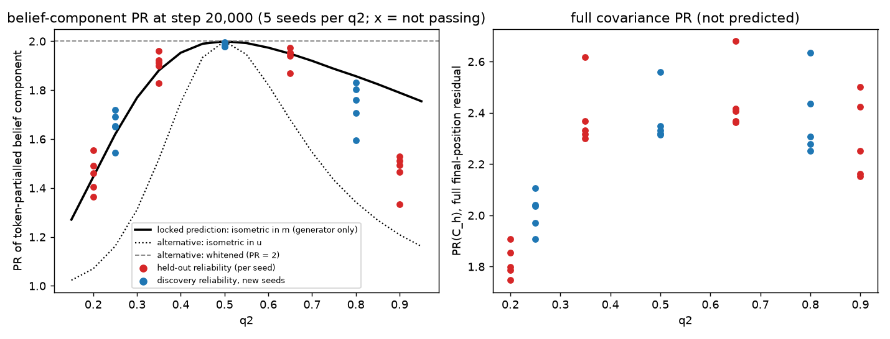
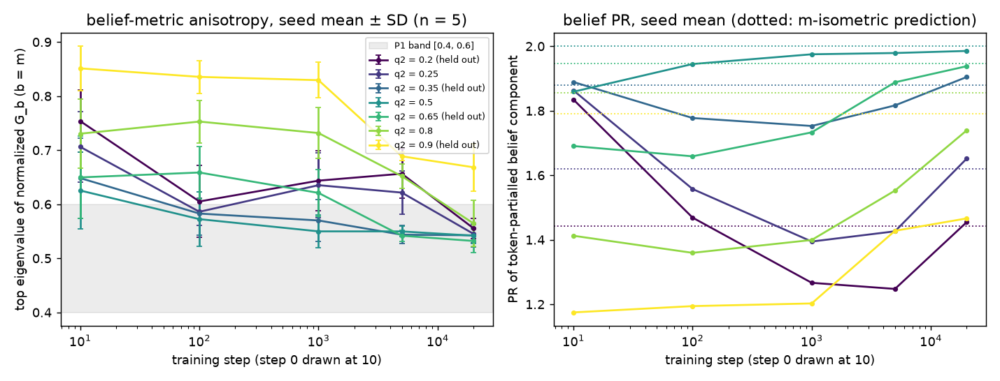

# Batch 4: locked prediction of the belief-component spectrum on held-out reliabilities

The locked prediction failed its headline test. The rule fixed before training says a one-layer transformer encodes the two belief coordinates isometrically in the probability coordinates m, so the PR of the belief component should follow a curve computed from the generator alone. Its seed-mean prediction holds within 2% at five of the seven reliabilities and within 7% at q2 = 0.8. One of the five is held-out q2 = 0.2, where the three alternatives all fail. But at held-out q2 = 0.9 it misses by e_PR = 0.22, with the prediction 22% above the observed value (predicted 1.791, observed 1.466 ± 0.078 over 5 seeds), and every one of the five q2 = 0.9 seeds misses by more than 10% (e_PR 0.17–0.34). Under the pre-set rules that one reliability makes the PR prediction (P2) **not supported** on both the held-out and the all-reliability scope, so the headline "P2-discriminating" verdict is **not met**. For the same reason the isotropy-band prediction (P1) is **not supported**: the q2 = 0.9 seed-mean top eigenvalue is 0.668 against a limit of 0.6. Two predictions are **supported**. Training moves the metric toward isotropy in 34 of 35 runs (P1-learned), and the metric is closer to isotropy in m than in the readout coordinates u in 29 of 30 anisotropic runs (P3). Every run finished and passed both gates (35 of 35), so this is a clean negative at the high-reliability end, not a failed run. At q2 = 0.9 the trained encoding sits between the m-isometric and u-isometric predictions, 44% of the way from u to m (an exploratory measure, not in the definition).

All numbers are at the final position, site `L0.resid_post` (the residual stream after the layer), step 20,000, on n_eval = 65,536 contexts (eval seed 7), five seeds (10–14) per reliability, unless stated otherwise. The definition, with its locked criteria, is [EXPERIMENT.md](EXPERIMENT.md), and the locked prediction is [predictions.json](predictions.json).

## The evidence

*Left: the PR of the token-partialled belief component at step 20,000, one point per run (5 seeds per q2, 35 runs, all passing). Red points are held-out reliabilities, never trained on or analyzed before this batch, and blue points are the discovery reliabilities with new seeds. The solid curve is the locked m-isometric prediction, the dotted curve the u-isometric alternative and the dashed line the whitened alternative (PR = 2). The prediction tracks the points from q2 = 0.2 to 0.65 and lies above all five q2 = 0.9 points. Right: PR(C_h) of the full 64-dimensional final-position residual, which was not predicted. Produced by [plot.py](plot.py).*

**What is measured.** For each run, the activation h is regressed on the two belief coordinates b and the final token's one-hot, h ≈ c + E[b, onehot(x_T)]. E_b is the two columns of E that multiply b, so it measures what the model encodes about the belief beyond token identity. G_b = E_bᵀE_b divided by its trace has two eigenvalues that sum to 1, and an encoding isometric in b gives (0.5, 0.5). The observed belief PR is PR(E_b Σ_b E_bᵀ), with Σ_b the generator's belief covariance on the eval contexts. The m-isometric prediction is (v1+v2)²/(v1²+v2²), where v1 and v2 are the two factors' belief variances. The u coordinates are u = atanh(ρqm), the log-odds the model would need to read out. e_PR = |predicted − observed| / observed. For example, run q2 = 0.9, seed 13 has G_b eigenvalues (0.744, 0.256) in m and (0.686, 0.314) in u, a belief PR of 1.334 against the predicted 1.791 (e_PR = 0.342), and it is the one anisotropic run where u is closer to isotropy than m.

| q2 | held out | m-isometric PR | observed PR, mean ± SD | e_PR, m (graded) | e_PR, whitened | e_PR, u-isometric | e_PR, own step 0 | runs with e_PR,m < 0.1 | top eig, m: mean [range] | in band | top eig at step 0 | m closer than u | factor-1 share |
|---|---|---|---|---|---|---|---|---|---|---|---|---|---|
| 0.2 | yes | 1.443 | 1.455 ± 0.074 | **0.008** | 0.375 | 0.265 | 0.261 | 5/5 | 0.555 [0.535–0.576] | 5/5 | 0.754 | 5/5 | 0.492 |
| 0.25 | no | 1.619 | 1.652 ± 0.067 | **0.020** | 0.211 | 0.297 | 0.128 | 5/5 | 0.545 [0.518–0.561] | 5/5 | 0.706 | 5/5 | 0.481 |
| 0.35 | yes | 1.880 | 1.905 ± 0.048 | **0.013** | 0.050 | 0.204 | 0.008 | 5/5 | 0.543 [0.520–0.570] | 5/5 | 0.648 | 5/5 | 0.479 |
| 0.5 | no | 2.000 | 1.985 ± 0.008 | **0.007** | 0.007 | 0.007 | 0.064 | 5/5 | 0.542 [0.520–0.556] | 5/5 | 0.625 | (m = u) | 0.493 |
| 0.65 | yes | 1.947 | 1.938 ± 0.040 | **0.005** | 0.032 | 0.135 | 0.128 | 5/5 | 0.532 [0.504–0.552] | 5/5 | 0.650 | 5/5 | 0.501 |
| 0.8 | no | 1.855 | 1.739 ± 0.094 | **0.066** | 0.150 | 0.229 | 0.188 | 4/5 | 0.565 [0.522–0.631] | 4/5 | 0.730 | 5/5 | 0.443 |
| 0.9 | yes | 1.791 | 1.466 ± 0.078 | **0.222** | 0.364 | 0.175 | 0.199 | 0/5 | **0.668** [0.636–0.744] | 0/5 | 0.851 | 4/5 | 0.334 |

*The e_PR columns are the graded quantity, computed from the seed-mean observed and seed-mean predicted PR at each reliability. Values ≥ 0.1 mean "not supported" for that hypothesis. SD is the sample SD over the 5 seeds. "In band" means both G_b eigenvalues lie in [0.4, 0.6]. The factor-1 share is G_b[0,0]/tr G_b in m, and 0.5 means both factors are encoded with equal gain. The predicted PRs are recomputed on the eval contexts and differ from the locked reference values in predictions.json by at most 0.003. The u-isometric PRs are 1.070, 1.162, 1.517, 2.000, 1.677, 1.340 and 1.210 in q2 order. Sources: [grade.json](grade.json), produced by the locked [grade.py](grade.py), and [extras.json](extras.json) for the run counts, ranges and factor-1 shares.*

**Against each criterion.** Every reliability has 5 of 5 passing runs, so every reliability counts toward every verdict.

- **Run validity: met.** 35 of 35 runs finished (`run_failed` is false). Every run's tail-mean final-position KL is below its k = 4 short-window floor, at 29–48% of the floor for q2 ≤ 0.65 and 69–85% for q2 = 0.8 and 0.9. The belief-content gain Δ is 0.16–0.41, against the 0.02 threshold, and is smallest at q2 = 0.9 (0.164–0.180). All 35 also pass under the single-final-evaluation bar.
- **P1, geometry: not supported.** 29 of 35 runs (83%) are in the band, which clears the 80% pooled requirement. But "supported" also needs every reliability's seed-mean top eigenvalue to be ≤ 0.6, and at q2 = 0.9 it is 0.668, with all five seeds above 0.6. The six runs outside the band are all five q2 = 0.9 seeds and q2 = 0.8 seed 13 (0.631). The same rule at step 0, the untrained reference, also gives "not supported": 6 of 35 runs are in the band, and the seed-mean top eigenvalues are 0.625–0.851.
- **P1-learned: supported.** In 34 of 35 runs (97%) the trained top eigenvalue is closer to 0.5 than at step 0. The exception is q2 = 0.5, seed 10, which went from 0.541 at step 0 to 0.552. This holds at q2 = 0.9 too, where training moves the seed mean from 0.851 to 0.668 but not into the band.
- **P2, the PR curve: not supported**, on both scopes. On the held-out scope {0.2, 0.35, 0.65, 0.9}, the seed-mean e_PR is 0.008, 0.013 and 0.005 at the first three and 0.222 at q2 = 0.9, and 15 of 20 runs have e_PR < 0.1. On all seven reliabilities, 29 of 35 runs do, and q2 = 0.9 is again the only reliability with a seed-mean e_PR ≥ 0.1.
- **The alternatives.** All three are "not supported" on both scopes. The whitened alternative fails at q2 = 0.2 (0.375) and 0.9 (0.364) but passes at 0.35 and 0.65 (0.050 and 0.032), as the definition anticipated. The u-isometric alternative fails at every reliability except 0.5, where it equals the prediction. Each run's own step-0 PR fails at q2 = 0.2, 0.65 and 0.9 (0.261, 0.128 and 0.199) but passes at 0.35 (0.008).
- **P2-discriminating (headline): not met.** It needs the m-isometric prediction supported and all three alternatives not supported on the held-out scope, and the first condition fails at q2 = 0.9. At q2 = 0.2 alone, the prediction passes (0.008) while all three alternatives fail (0.26–0.38), but the criterion is set over the held-out scope as a whole.
- **P3, m over u: supported.** 29 of 30 anisotropic runs (97%) are closer to isotropy in m than in u. Every reliability has 5 of 5 except q2 = 0.9, which has 4 of 5 (seed 13).

**Reported, not graded.**

- **P3 before training:** at step 0 the m-over-u ordering holds in 17 of 30 anisotropic runs (57%), so it is much weaker there than after training. Training widens the gap between u's and m's distance from isotropy in 29 of 30 runs.
- **Ordering of the seven seed means:** the observed order is 0.2 < 0.9 < 0.25 < 0.8 < 0.35 < 0.65 < 0.5, and the predicted order puts 0.9 above 0.25. These two are the only swap, which follows from the q2 = 0.9 shortfall.
- **The direction of the miss:** at q2 = 0.8 and 0.9, factor 2 has the larger belief variance (v2 = 0.737 and 0.849 against v1 ≈ 0.42), and the trained metric gives it more than its isometric share (factor-1 share 0.443 and 0.334, against 0.48–0.50 at the other reliabilities). That makes the belief component more anisotropic than m-isometry predicts and moves the PR toward the u-isometric value, which distorts in the same direction. On a scale where u-isometric is 0 and m-isometric is 1, the seed-mean observed PR sits at 1.03, 1.07, 1.07, 0.97, 0.78 and 0.44 for q2 = 0.2, 0.25, 0.35, 0.65, 0.8 and 0.9. The miss isn't explained by generator anisotropy alone: q2 = 0.2 is also strongly anisotropic (v2/v1 = 0.23, against 2.04 at q2 = 0.9), with factor 2 the smaller one, and there the prediction holds within 1%.
- **PR(C_h), the full residual:** seed means of 1.819 ± 0.063, 2.012 ± 0.076, 2.387 ± 0.131, 2.375 ± 0.104, 2.447 ± 0.132, 2.381 ± 0.158 and 2.298 ± 0.157 in q2 order (right panel above). It rises from q2 = 0.2 to 0.35 and is flat to within the seed spread from 0.35 to 0.9. Unlike the belief PR, it doesn't peak at q2 = 0.5.
- **Replication at the discovery reliabilities:** at q2 = 0.8 the new seeds give a belief PR of 1.739 and top eigenvalue 0.565, against Batch 2's three-seed means of 1.741 and 0.562 (Batch 2's write-up is [here](../transformer-discovery/README.md)). At q2 = 0.5 they give 1.985 against 1.992. At q2 = 0.25 the top eigenvalue replicates (0.545 against 0.542), but the belief PR is 6% higher than Batch 2's (1.652 ± 0.067 against 1.553 ± 0.025), about three standard errors, and closer to the prediction.

*Seed means over training (n = 5 per q2), at the five analyzed checkpoints 0, 100, 1,000, 5,000 and 20,000, with step 0 drawn at 10 on the log axis. Left: the top eigenvalue of G_b in m, ± seed SD, with P1's band shaded. Right: the belief PR, with each reliability's m-isometric prediction dotted in the same color. Produced by [extras.py](extras.py).*

**Belief-PR trajectories.** At q2 = 0.2 and 0.25 the belief PR falls well below the prediction by step 1,000–5,000 (1.25–1.43) and climbs back to it by step 20,000. At q2 = 0.8 and 0.9 the metric is still moving toward isotropy between steps 5,000 and 20,000. At q2 = 0.8 the top eigenvalue goes from 0.652 to 0.565 and the PR from 1.552 to 1.739. At q2 = 0.9 the change is smaller, 0.689 to 0.668 and 1.428 to 1.466. With only two late checkpoints these trajectories can't say where q2 = 0.9 would settle.

## How it was done

The model is the Batch 2 baseline: a decoder-only transformer with one layer, d = 64, two heads of width 32, a GELU MLP of width 256 and no normalization. It was trained online with Adam at lr = 1e-3 on fresh length-16 contexts (batch 256, 20,000 steps). The contexts come from two independent binary hidden factors with (ρ, q) = (0.8, 0.5) and (0.8, q2). Seven reliabilities q2 ∈ {0.2, 0.25, 0.35, 0.5, 0.65, 0.8, 0.9} were run with seeds 10–14. Seeds 0–2 and 100 were used in Batch 2, so these are new. Four reliabilities (0.2, 0.35, 0.65, 0.9) had never been trained on or analyzed before. The prediction, the criteria and `grade.py` were committed before launch (commit 723c40b). The controls were each run's step-0 checkpoint, the final-token one-hot partialled out of the belief block, and the three alternative predictions graded by the same rule. The worker ran the code at that commit. One A40 trained the 35 runs in 24 min (four at a time) and analyzed 175 checkpoints in 43 min. The worker was up 1.16 h in total, for about $0.68 against the $8 budget and 3 h cap. Commands and the driver are in [EXPERIMENT.md](EXPERIMENT.md) and [run.sh](run.sh), and training and analysis logs are in [logs/](logs/).

## How it was checked

- **The locked files were not changed.** `predictions.json`, `grade.py` and `run.sh` are identical to the launch commit 723c40b. The worker's code had no uncommitted changes (orch's recorded launch diff is empty). The only later change under `prt/` adds checkpoint steps past 20,000 for another experiment, and it was committed after this worker launched.
- **The grader's numbers match the raw analysis.** For q2 = 0.9, seed 13, `runs/transformer-confirm/q0.9_s13/analysis/step_020000.json` gives G_b eigenvalues (0.744, 0.256) in m and (0.686, 0.314) in u, a belief PR of 1.334 and a predicted PR of 1.791, the same as `grade.json`.
- **The q2 = 0.9 miss isn't one seed.** All five seeds have e_PR between 0.17 and 0.34 and top eigenvalues between 0.636 and 0.744, so this isn't the single-outlier case the pooled rules were designed to absorb. The seed mean itself fails.
- **The discovery reliabilities mostly replicate with new seeds.** The top eigenvalue matches Batch 2's means within 0.011 at all three discovery reliabilities, and so does the belief PR at q2 = 0.5 and 0.8. At q2 = 0.25 the new seeds' belief PR is 6% higher than Batch 2's (about three standard errors), and closer to the prediction. The code is identical to Batch 2's, and the longer-training follow-on reproduced Batch 2's seeds to 1.1e-4, so a code or setup difference is an unlikely explanation for the q2 = 0.9 result.
- **Fact-check pass:** a fact-checker agent checked about 175 claims against `grade.json`, `extras.json`, the raw analysis files, the orch records, git history and the two earlier write-ups, and found six that didn't fully hold. All are corrected above. One was wrong: the earlier draft said two of six q2 = 0.8 seeds in the 50,000-step follow-on moved away from isotropy, and the source shows four did. Two were overstated. The draft said the discovery reliabilities replicate, but the q2 = 0.25 belief PR doesn't, and it said "within 2%" without noting that this holds for seed means only. Three were incomplete or misattributed the mechanism: the step-0 alternative also fails at 0.65, the q2 = 0.8 result was missing from the opening count, and the draft said the pooled rules "do not apply" when it is the seed-mean condition that fails. No verdict changed.

## Not yet checked

- **Whether the q2 = 0.9 encoding settles into the band with more training.** Its metric was still moving slowly between steps 5,000 and 20,000. The longer-training follow-on (Batch 2b, [README](../transformer-longrun/README.md)) ran 50,000 steps at q2 = 0.25, 0.5 and 0.8 and found that q2 = 0.8 seeds don't drift toward isotropy. Four of six ended further from it at 50,000 steps, two of them steadily (from 0.53–0.54 to 0.60–0.61), and the seed-mean top eigenvalue rose from 0.547 to 0.570. That argues against "undertrained" as the explanation, but it didn't include q2 = 0.9. Training the five q2 = 0.9 seeds to 50,000 steps would take about 20–30 min on one A40, under $0.5, and would decide whether the P1 and P2 failures describe the trained solution or a transient.
- **The shape of the departure between 0.8 and 0.95.** Two reliabilities above 0.65 show a miss, a mild one at 0.8 and a large one at 0.9. Points at 0.85 and 0.95 would show whether the departure grows smoothly with q2, which would bear on the explanation (for example, a smooth crossover from m-isometric toward u-isometric as the readout becomes more nonlinear). This costs minutes per run.
- **Other sites.** Only `resid_post` was graded. The other sites are in [results.json](results.json) but were not examined here.

## Judgement calls

- **The reported quantities were computed after grading by a new script, [extras.py](extras.py).** These are the counts, ranges, factor-1 shares, the position between u and m, and the trajectories. The script reads only `results.json` and `grade.json` and changes no verdict. The position between u and m and the factor-1-share comparison weren't named in the definition, so they are exploratory and rest on these seven reliabilities.
- **The result is recorded as `not-supported`, not `inconclusive`.** The definition's rule makes any seed-mean e_PR ≥ 0.1 in scope a "not supported", and q2 = 0.9 gives 0.222 with 5 of 5 seeds above 0.1. As a post hoc observation, leaving out q2 = 0.9 would leave the six other reliabilities meeting the P2 rule (every seed-mean e_PR < 0.1 and 29 of 30 runs below 0.1). But q2 = 0.9 was added to the held-out set precisely because it is where the alternatives differ, so dropping it would remove the test the batch was designed to run.

## What this means

The m-isometric rule is a good description of the trained belief metric from q2 = 0.2 to 0.65. It predicts the seed-mean belief PR within 2% there and every individual run within 8%, including at held-out q2 = 0.2, where the whitened, u-isometric and untrained alternatives miss by 26–38%. It doesn't hold as a law over the whole reliability range at 20,000 steps. At q2 = 0.9 the network gives the high-variance factor extra gain, and its PR lands about halfway between the m-isometric and u-isometric curves. The useful next step is to train the q2 = 0.9 seeds longer and add q2 = 0.85 and 0.95, which together cost under $1. That would show whether the high-reliability departure is a stable, growing crossover toward u that a theory has to explain, or an unfinished stage of training.
