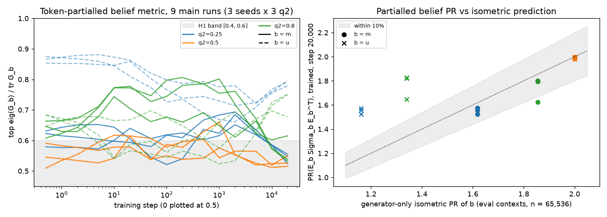

# Batch 2: small-transformer discovery on the binary two-factor generator

After 20,000 steps of online training, a one-layer transformer's token-partialled belief encoding is much nearer isometric in the probability coordinates m than in the readout coordinates u = atanh(ρqm), and is clearly not isometric in u. In all six anisotropic runs the belief metric's top normalized eigenvalue is 0.52–0.62 in m against 0.68–0.80 in u, where 0.5 is isotropic, so H1u (isometric in u) is **not supported**. H1 (isometric in m) is **inconclusive** under the graded rule. One of the three q2 = 0.8 seeds has a top eigenvalue of 0.615, just outside the pre-set 0.4–0.6 band, while the other eight runs fall inside it and match the m-isometric PR to within 7%. Under the definition's original prediction-quality bar that one run would have been excluded, and H1 would have read "supported" (see "Judgement calls"). The same m-over-u ordering already holds, more weakly, in the untrained models, where the belief signal is almost nil. These verdicts describe learned structure because training adds a large belief component beyond token identity (held-out R² gain 0.24–0.45, against 0.002–0.005 at initialization), and at q2 = 0.8 training widens the gap between the two metrics' top eigenvalues, from 0.001–0.08 to 0.06–0.22. PR(C_h) is consistent across seeds (CV 1.7–4.7%) and well measured, but it fell between the 10,000- and 20,000-step checkpoints in every main run, so every final-step verdict describes a representation that had not settled by 20,000 steps.

All numbers are at the final position, site `L0.resid_post` (the residual stream after the layer), step 20,000, on n_eval = 65,536 held-out contexts, unless stated otherwise. The definition, with its criteria and one amendment, is [EXPERIMENT.md](EXPERIMENT.md).

## The evidence

*Left: the top eigenvalue of the trace-normalized belief metric G_b, with token identity partialled out, against training step for the nine main runs (three seeds at each q2). Solid lines are b = m and dashed lines b = u; at q2 = 0.5 the two coincide. The shaded strip is H1's band [0.4, 0.6]. Right: at step 20,000, the PR of the belief part of the representation, PR(E_b Σ_b E_bᵀ), against the generator-only PR that an isometric encoding of the same coordinates would give. The m points (circles) lie on or near the diagonal, and the u points (crosses) at q2 ≠ 0.5 sit well above it (e_PR 0.19–0.27).*

**The belief metric, defined.** For each run, h ≈ c + E[b, onehot(x_T)] is fitted on 32,768 contexts, where h is the 64-dimensional activation, b the two belief coordinates and x_T the final token. E_b is the two columns of E that multiply b. Because the final token's one-hot sits in the same fit, E_b measures what the model encodes about the belief beyond token identity. G_b = E_bᵀE_b divided by its trace has two eigenvalues summing to 1, and an encoding isometric in b gives (0.5, 0.5). For example, run `main_q0.25_s0` (q2 = 0.25, seed 0) has G_b eigenvalues (0.524, 0.476) in m and (0.796, 0.204) in u. Its partialled belief PR is 1.575, against 1.619 for an m-isometric encoding (e_PR = |1.619 − 1.575|/1.575 = 0.028) and 1.162 for a u-isometric one (e_PR = 0.26).

| run (q2, seed) | KL tail mean / k=4 floor | Δ belief content | top eig, m | e_PR, m | factor-1 share, m | top eig, u | e_PR, u | PR(C_h) |
|---|---|---|---|---|---|---|---|---|
| 0.25, 0 | 0.00059 / 0.00144 | 0.447 | 0.524 | 0.028 | 0.522 | 0.796 | 0.262 | 2.034 |
| 0.25, 1 | 0.00061 / 0.00144 | 0.404 | 0.555 | 0.062 | 0.548 | 0.779 | 0.238 | 1.944 |
| 0.25, 2 | 0.00054 / 0.00144 | 0.395 | 0.547 | 0.039 | 0.529 | 0.793 | 0.254 | 2.137 |
| 0.5, 0 | 0.00079 / 0.00224 | 0.398 | 0.515 | 0.001 | 0.507 | = m | = m | 2.527 |
| 0.5, 1 | 0.00085 / 0.00224 | 0.374 | 0.551 | 0.009 | 0.491 | = m | = m | 2.444 |
| 0.5, 2 | 0.00076 / 0.00224 | 0.387 | 0.526 | 0.003 | 0.525 | = m | = m | 2.469 |
| 0.8, 0 | 0.00093 / 0.00132 | 0.241 | 0.538 | 0.033 | 0.469 | 0.750 | 0.263 | 2.402 |
| 0.8, 1 | 0.00100 / 0.00132 | 0.240 | 0.532 | 0.029 | 0.473 | 0.752 | 0.266 | 2.440 |
| 0.8, 2 | 0.00113 / 0.00132 | 0.240 | **0.615** | **0.141** | 0.385 | 0.677 | 0.186 | 2.313 |

*Columns: "KL tail mean" is the mean final-position KL(Bayes‖model) over the 21 validation evaluations in steps 15,000–20,000 (8,192 fixed contexts each), and "k=4 floor" is the KL of the exact best predictor that sees only the last four tokens. Δ is the held-out R² gain of adding m to the final-token one-hot, at step 20,000 minus the same at step 0. The factor-1 share is G_b[0,0]/tr G_b. The m-isometric PRs are 1.619, 2.000 and 1.855 for q2 = 0.25, 0.5 and 0.8, and the u-isometric PRs are 1.162, 2.000 and 1.340. Source: [grade.json](grade.json), produced by [grade.py](grade.py) from [results.json](results.json) and the runs' `metrics.jsonl`.*

**Against each criterion** (passing run = clears the KL bar and has Δ > 0.02; all nine main runs pass):

- **Prediction-quality bar (amended rule A1, tail mean below the k = 4 floor):** met by all nine. The tail mean is 34–43% of the floor at q2 = 0.25 and 0.5, and 70–86% at q2 = 0.8, so the q2 = 0.8 models clear the floor by a narrower margin. As a fraction of KL(Bayes‖uniform) the tail-mean excess is 1.5–1.7%, 1.1–1.2% and 0.47–0.57% for the three q2 values. Under the original single-final-evaluation rule, eight of nine pass. `main_q0.8_s2` ends at 0.0013245 against its floor of 0.0013196 and misses by 0.4%.
- **Belief-content precondition (Δ > 0.02):** met by all nine. Δ is 0.39–0.45 at q2 = 0.25, 0.37–0.40 at q2 = 0.5 and 0.240–0.241 at q2 = 0.8, against −0.001 in the shuffled-token control, so every main run exceeds the shuffled value.
- **H1 (isometric in m): inconclusive.** "Supported" needs every passing run in the band with e_PR < 0.1, and `main_q0.8_s2` fails both (0.615 and 0.141). "Not supported" needs every seed of some condition above 0.6, or a factor-1 share that differs by more than 0.1 between q2 = 0.25 and q2 = 0.8. Neither holds: one of three q2 = 0.8 seeds is above 0.6, and the share difference is 0.533 − 0.443 = 0.091. Under the original bar `main_q0.8_s2` drops out, the share difference becomes 0.062, every remaining run passes, and H1 reads **supported**.
- **H1u (isometric in u): not supported** under either bar. Every seed at q2 = 0.25 and q2 = 0.8 has its top eigenvalue above 0.6 (0.68–0.80), and the factor-1 share in u moves from 0.21 to 0.73 between those conditions (difference 0.51). The u-isometric PR underpredicts the partialled belief PR by 19–27%.
- **m versus u: m favored, 6 of 6.** In every anisotropic run the m metric's top eigenvalue is closer to 0.5 than the u metric's.
- **Seed consistency: met.** CV of PR(C_h) across seeds is 4.7%, 1.7% and 2.7% for q2 = 0.25, 0.5 and 0.8, using the sample standard deviation (3.9%, 1.4% and 2.2% with the population form). Prediction quality is matched within 2× in every condition: the max/min ratio of tail-mean KL is 1.14, 1.12 and 1.21.
- **Measurement validity: met.** PR(C_h) at n_eval 65,536 is within 0.24% of the 262,144-context value in every main run (largest gap at q2 = 0.25, seed 1).
- **Shuffled-token control:** Δ_shuf = −0.001, below the 0.01 threshold, so there's no sign of residual memory or a pipeline artifact. (This model has no k = 4 floor to beat, since IID tokens make the floor zero.)
- **Token-permutation control: passes** for both relabelled runs. At q2 = 0.25 the relabelled run gives top eigenvalue 0.543 in m and 0.802 in u, with PR(C_h) = 1.995. At q2 = 0.8 it gives 0.562, 0.732 and 2.358. All six values fall inside the main condition's seed range widened by 0.05 (by 5% for PR).

**H4, nuisance content (descriptive).** Token identity dominates the untrained model and remains a large share after training. At step 0 the final token's one-hot explains 98–99% of the activation variance at `resid_post`, and m alone explains 37–51%. At step 20,000 the one-hot explains 54%, 57% and 72% (seed means for q2 = 0.25, 0.5 and 0.8, seed range within ±0.025), m alone 87–89%, and m with the one-hot 95–96%. At the embedding site the one-hot explains 100%, as it must.

## How it was done

The model is a decoder-only transformer with one layer, d = 64, two heads of width 32, a GELU MLP of width 256 and no normalization. It was trained online with Adam on fresh length-16 contexts from two independent binary hidden factors with (ρ, q) = (0.8, 0.5) and (0.8, q2), for q2 ∈ {0.25, 0.5, 0.8}, three seeds each. Training used batch 256 for 20,000 steps at lr = 1e-3. A pre-declared rule chose the learning rate from three pilots at q2 = 0.5: 1e-4, 3e-4 and 1e-3 were all stable, and 1e-3 was the largest within 20% (+1e-4 nats) of the best final KL (0.00059 against 0.00052; [lr.json](lr.json)). All 15 checkpoints of every run were analyzed at five sites on 65,536 independent contexts, with regressions fitted on one half and evaluated on the other. The controls were step-0 checkpoints, token-identity regressors, an IID shuffled-token run and two runs with a different token labelling. The full method and commands are in [EXPERIMENT.md](EXPERIMENT.md), and the driver is [run.sh](run.sh). The work ran on one A40 in 1 h 19 min, about $0.78 against the $8 budget and 3 h cap.

## How it was checked

- **Evaluation-sample size:** every main run was re-analyzed at its final checkpoint with 16,384 and 262,144 contexts. PR(C_h) moved by at most 0.25% between 65,536 and 262,144 contexts and by at most 0.51% at 16,384, and the partialled top eigenvalue in m moved by at most 0.001. In particular `main_q0.8_s2` gives 0.616, 0.615 and 0.615 at the three sample sizes, so its distance from the band reflects the trained weights, not regression noise.
- **Step-0 baseline:** before training, the partialled metric in m already has top eigenvalues of 0.51–0.66, and 4 of the 9 untrained runs would pass the per-run H1 test (all three at q2 = 0.5, plus q2 = 0.25 seed 0). The test can't separate them from trained runs on that basis alone. The belief-content precondition is what separates them: at step 0, adding m to the one-hot raises R² by only 0.002–0.005, so the untrained belief block rests on almost no signal. At q2 = 0.8 the m metric moves away from isotropy during training (0.72–0.80 at steps 1k–2k for two of the three seeds) and comes back toward it by step 20k (left panel), and at q2 = 0.25 it departs to 0.65–0.69 at step 2k. So in the anisotropic conditions the final isotropy isn't left over from initialization. At q2 = 0.5 the untrained runs already pass, and only the belief-content precondition separates them. The same holds for m versus u: at step 0, m is already closer to isotropy than u in all six anisotropic runs (q2 = 0.25: 0.58–0.63 against 0.85–0.88; q2 = 0.8: 0.61–0.66 against 0.65–0.69, with seed 1 at 0.646 against 0.647), and every untrained q2 = 0.25 and 0.8 seed has its u top eigenvalue above 0.6. So these verdicts also rest on the belief-content precondition to be about learned structure. Training widens the q2 = 0.8 gap, from 0.001–0.08 at step 0 to 0.06–0.22 at step 20k.
- **Prediction-quality bar under both rules:** both verdicts are computed and reported above, since the amended rule changes the H1 verdict.
- **Grading code:** [grade.py](grade.py) implements the definition's rules. It was written at 22:02 UTC, while the worker was still analyzing, and before any belief-metric, H1/H1u or seed-consistency quantity had been read. The KL-bar values had already been read for amendment A1. It grades from results.json and the runs' metrics.jsonl, and its numbers agree with the raw `analysis/step_020000.json` values spot-checked for `main_q0.8_s2`.
- **Fact-check pass:** a fact-checker agent checked about 120 claims against `grade.json`, `results.json`, the run logs and git history, and 13 didn't fully hold. They were mostly rounding and scope errors, all now corrected. Two changed the reading. The headline said "encodes close to isometrically in m", which the inconclusive H1 doesn't support. And the step-0 check had left out that m-over-u and the H1u rejection also hold before training, which is now stated above along with what separates trained from untrained models.

## Not yet checked

- **Whether the representation settles with more training.** PR(C_h) rises from about 2.9 at initialization to a peak of 3.7–4.5 around step 5,000, then falls to 1.9–2.5 by step 20,000, and it dropped between steps 10,000 and 20,000 in every main run ([trajectories.png](figures/trajectories.png)). The m metric's top eigenvalue at q2 = 0.8 is also still moving (0.57–0.60 at 10k, 0.53–0.62 at 20k). The H1 verdict and the PR values depend on this. At the observed 3.7–4 min per 20,000 steps with four runs at once, extending the nine main runs to 50k steps would take about 30 min of training on one A40, and 100k about an hour, plus analysis, roughly $0.5–1. The definition fixes 20,000 steps, and its one extension clause says not to extend inside this experiment, while plan §8.1 asks for the reason to be documented first.
- **More seeds at q2 = 0.8.** H1 turns on one seed out of three. Three to six more seeds would show whether 0.615 is a tail case or typical, at minutes per run.
- **Other sites.** Only `resid_post` was graded. Apart from the embedding-site check in H4, the other four sites are in [results.json](results.json) but weren't examined for this write-up.

## Judgement calls

- **The prediction-quality bar was amended after training, before grading.** The planning session asked for the bar to use the mean of the last quarter of evaluations instead of the single final one (amendment A1 in [EXPERIMENT.md](EXPERIMENT.md)), because at q2 = 0.8 the final-position KL fluctuates between 0.0006 and 0.0018 over steps 15k–20k around a floor of 0.00132. A single evaluation therefore decides the bar by noise. The change arrived after training had finished, and the supervisor's check of the logs showed it would admit `main_q0.8_s2`, but no belief-metric quantity had been looked at. The amended rule turns out to decide H1: with it H1 is inconclusive, and without it H1 is supported. The tail mean is the less noisy measure of whether a model beats the floor, so this write-up grades with it. A reader who prefers the original rule should read H1 as supported on 8 runs, with the q2 = 0.8 condition resting on two seeds.
- **Seed-consistency CV uses the sample standard deviation** (n − 1). The definition doesn't say which. The population form gives smaller CVs (3.9% at most), so the verdict doesn't change.
- **The m-versus-u count uses all six anisotropic runs,** as the definition words it. All six are passing runs, so restricting to passing runs gives the same 6 of 6.

## What this means

For the next theory step, the encoding at this scale is closer to isometric in the probability coordinates m than in the readout coordinates u. The PR of the belief part follows the m-isometric prediction to within 7% in eight of nine runs, while in the six anisotropic runs the u-isometric prediction misses by 19–27%. So the readout-coordinate theory level is disfavored for this architecture. The final-token one-hot alone explains 54–72% of the activation variance at the graded site, though it adds only 7–8% beyond m, and any PR law for the whole C_h has to account for that token component. The m-over-u preference also appears weakly in untrained models, so the next work should ask why a generic encoding favors m as well as how training sharpens it. Whether "isometric in m" holds as a law depends on the open q2 = 0.8 case and on training past 20,000 steps, and both of those are cheap to run as a follow-on.
