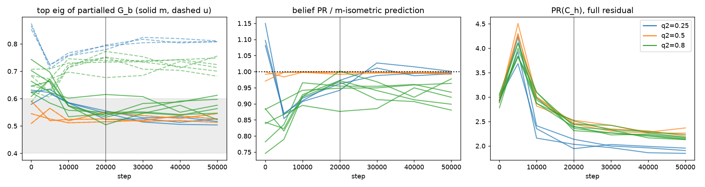

# Batch 2b: the m-isometric belief metric at 50,000 training steps

Training the small transformer 2.5× longer (from 20,000 to 50,000 steps) leaves the token-partialled belief metric close to isotropic in the probability coordinates m, and the pre-registered verdict is **stable m-isometry**. At 50,000 steps 11 of 12 runs have the metric's top eigenvalue in the band [0.4, 0.6], where 0.5 is isotropic. All 9 runs with an anisotropic generator are closer to isotropy in m than in the readout coordinates u, and the median absolute change of the top eigenvalue from 20,000 to 50,000 steps is 0.019, against a threshold of 0.05. The caveat is the q2 = 0.8 condition, whose seeds do not hold still. Two of its six seeds rose steadily from 0.53–0.54 to 0.60–0.61 over those 30,000 steps, and one of them ended just outside the band (0.612). Batch 2's outlier seed went the other way, back into the band. So "in band at q2 = 0.8" is a property of most seeds at any one trained checkpoint (10k on), and individual seeds move across the edge. Batch 2's stricter rule, which required every run in band with the belief PR within 10% of the m-isometric prediction, still fails at 50k, now on two q2 = 0.8 runs instead of one. PR(C_h), the participation ratio of the full residual-stream covariance, has not settled: it fell by a median 9.1% between 20,000 and 50,000 steps, and was still falling by 2.7% over the last 10,000.

All numbers are at the final position, site `L0.resid_post` (the residual stream after the layer), on n_eval = 65,536 held-out contexts, unless stated otherwise. The definition, with its criteria, is [EXPERIMENT.md](EXPERIMENT.md).

## The evidence

*All 12 runs, colored by q2 (blue 0.25, orange 0.5, green 0.8). Analysis at steps 0, 5k, 10k, 20k, 30k, 40k and 50k; the vertical line marks 20k, where Batch 2 stopped. Left: top eigenvalue of the trace-normalized, token-partialled belief metric G_b, in m (solid) and u (dashed), with the band [0.4, 0.6] shaded; at q2 = 0.5 m and u coincide. Middle: the PR of the belief part of the representation divided by the PR an m-isometric encoding would give (1 = exact agreement). Right: PR(C_h) of the full 64-dimensional residual.*

**The quantity graded.** For each run and checkpoint, h ≈ c + E[b, onehot(x_T)] is fitted on 32,768 contexts, where h is the activation, b the two belief coordinates and x_T the final token. E_b is the two columns of E that multiply b, so it measures what the model encodes about the belief beyond token identity. G_b = E_bᵀE_b divided by its trace has two eigenvalues summing to 1, and an encoding isometric in b gives (0.5, 0.5). For example, the q2 = 0.8, seed 0 run has top eigenvalue 0.538 in m and 0.750 in u at 20k, and 0.612 in m and 0.682 in u at 50k. Its distance from isotropy grew in m (0.038 → 0.112) and shrank in u (0.250 → 0.182).

| q2, seed | tail KL / k=4 floor | top eig m: 20k → 30k → 40k → 50k | Δ (50k − 20k) | top eig u: 20k → 50k | belief PR / m-iso pred, 50k | PR(C_h): 20k → 50k |
|---|---|---|---|---|---|---|
| 0.25, 0 | 0.28 | 0.524 → 0.526 → 0.514 → 0.526 | +0.002 | 0.796 → 0.808 | 0.993 | 2.034 → 1.848 |
| 0.25, 1 | 0.25 | 0.555 → 0.530 → 0.533 → 0.516 | −0.039 | 0.779 → 0.811 | 1.001 | 1.944 → 1.955 |
| 0.25, 2 | 0.29 | 0.547 → 0.514 → 0.506 → 0.504 | −0.043 | 0.793 → 0.808 | 0.996 | 2.137 → 1.905 |
| 0.5, 0 | 0.23 | 0.515 → 0.521 → 0.537 → 0.525 | +0.010 | = m | 0.998 | 2.527 → 2.369 |
| 0.5, 1 | 0.26 | 0.551 → 0.538 → 0.527 → 0.545 | −0.005 | = m | 0.992 | 2.445 → 2.262 |
| 0.5, 2 | 0.22 | 0.526 → 0.517 → 0.520 → 0.513 | −0.013 | = m | 0.999 | 2.469 → 2.201 |
| 0.8, 0 | 0.52 | 0.538 → 0.582 → 0.588 → **0.612** | +0.074 | 0.750 → 0.682 | 0.880 | 2.402 → 2.167 |
| 0.8, 1 | 0.57 | 0.532 → 0.564 → 0.591 → 0.597 | +0.065 | 0.752 → 0.700 | 0.899 | 2.440 → 2.177 |
| 0.8, 2 | 0.55 | **0.615** → **0.607** → 0.550 → 0.576 | −0.039 | 0.677 → 0.713 | 0.920 | 2.313 → 2.132 |
| 0.8, 3 | 0.58 | 0.504 → 0.546 → 0.576 → 0.523 | +0.019 | 0.773 → 0.756 | 0.978 | 2.512 → 2.129 |
| 0.8, 4 | 0.63 | 0.545 → 0.548 → 0.540 → 0.564 | +0.019 | 0.739 → 0.724 | 0.936 | 2.388 → 2.232 |
| 0.8, 5 | 0.54 | 0.550 → 0.551 → 0.542 → 0.547 | −0.003 | 0.733 → 0.748 | 0.963 | 2.359 → 2.144 |

*"Tail KL / k=4 floor" is the mean final-position KL(Bayes‖model) over the validation evaluations in steps 37,500–50,000, divided by the KL of the exact best predictor that sees only the last four tokens; below 1 means the model has learned beyond a four-token window. Bold marks values outside [0.4, 0.6]. The m-isometric PRs are 1.619, 2.000 and 1.855 for q2 = 0.25, 0.5 and 0.8. Source: [grade.json](grade.json), made by [grade.py](grade.py) from [stability.json](stability.json) and [results.json](results.json).*

**Against each criterion:**

- **Run succeeded: met.** All 12 runs reached 50,000 steps with analysis at 20k and 50k (threshold 10).
- **Prediction-quality filter: all 12 pass.** Every run's last-quarter tail-mean KL is below its k = 4 floor, at 22–29% of the floor for q2 = 0.25 and 0.5 and 52–63% for q2 = 0.8. All nine runs that repeat Batch 2's (seeds 0–2) are further below the floor than at their own 20k checkpoint (34–86% there, over steps 15k–20k), so the longer training improved prediction. No run is flagged, and every graded rule below uses all 12.
- **Stable m-isometry: met on all three rules.** 11 of 12 runs (92%) are in band at 50k (threshold 80%), the exception being q2 = 0.8 seed 0 at 0.612. In 9 of 9 anisotropic runs (q2 = 0.25 and 0.8) the m metric is closer to 0.5 than the u metric (threshold 80%). The median |Δ| from 20k to 50k is 0.019 (threshold 0.05).
- **Drift: not met.** The median |Δ| is under 0.05, and 92% are in band, above the 50% floor. The u-minus-m gap in distance from isotropy shrank in 4 of 9 anisotropic runs (all four at q2 = 0.8: seeds 0, 1, 3 and 4), short of the 80% that would call the direction "toward u".
- **PR(C_h) settling (reported, not graded): not settled.** The median relative change from 40k to 50k is −2.7% (median absolute change 3.0%), and 11 of 12 runs fell over that interval. The fall is much slower than before 20k: the median change per 10,000 steps was −17.3% from 10k to 20k, then −4.0%, −2.1% and −2.7% over the next three intervals, with no further slowing over the last two.
- **Reproducibility of seeds 0–2 against Batch 2 at 20k (reported): agree to within 1.1e-4.** In all nine reused runs the partialled top eigenvalue differs from Batch 2's by at most 0.00011, and PR(C_h) by at most 0.01% relative, so GPU nondeterminism had no visible effect and Batch 2's 20k values serve directly as this run's 20k reference.
- **q2 = 0.8 seeds 3–5 against Batch 2's outlier (reported).** The three new seeds have top eigenvalues of 0.504, 0.545 and 0.550 at 20k, all inside the band, so at 20k one of six q2 = 0.8 seeds (Batch 2's seed 2, at 0.615) is outside. That seed returned to the band by 40k (0.550) and ended at 0.576, while seed 0 left it at 50k. In every analyzed checkpoint from 10k on, exactly one or zero of the 12 runs is out of band, and it is always a q2 = 0.8 seed.
- **Belief PR against the m-isometric prediction over time (reported).** At q2 = 0.25 and 0.5 the ratio converges to 1 (0.992–1.001 at 50k; 0.94–1.00 at 20k). At q2 = 0.8 it is below 1 in all six runs at 50k (0.880–0.978, mean 0.93), against 0.876–1.002 (mean 0.95) at 20k. The two seeds whose top eigenvalue rose most (seeds 0 and 1, +0.074 and +0.065) have the two lowest ratios (0.880 and 0.899), which is the PR shortfall that a top eigenvalue near 0.6 implies. In terms of Batch 2's e_PR = |predicted − observed| / observed belief PR, 10 of 12 runs have e_PR < 0.1 at 50k; the two exceptions are q2 = 0.8 seeds 0 (0.136) and 1 (0.113), so Batch 2's H1 rule (every run in band with e_PR < 0.1) would fail on two runs here, against one at 20k.

**Per condition (not pre-registered; computed after the results were seen, not in grade.py).** The graded rules pool the three conditions, and the q2 = 0.25 and 0.5 runs are quieter than the q2 = 0.8 runs, so the pooled median partly reflects the mix. Applying the same rules to q2 = 0.8 alone still gives "stable": 5 of 6 in band (83%), 6 of 6 m-closer, and median |Δ| = 0.029. That condition passes the in-band rule with no run to spare: one more out-of-band seed would fail it. At q2 = 0.25 the metric moved toward isotropy (two seeds by about −0.04), and the u metric moved slightly away from it (0.78–0.80 → 0.81). At q2 = 0.5 no top eigenvalue changed by more than 0.013 between 20k and 50k.

## How it was done

The model and training are Batch 2's baseline exactly ([../transformer-discovery/README.md](../transformer-discovery/README.md)): a one-layer decoder-only transformer, d = 64, two heads of width 32, GELU MLP of width 256, no normalization, trained online with Adam (lr 1e-3, batch 256, context length 16) on two independent binary hidden factors with (ρ, q) = (0.8, 0.5) and (0.8, q2). The only change is the length, 50,000 steps instead of 20,000. Twelve runs: q2 ∈ {0.25, 0.5, 0.8} × seeds 0–2 (the same data and init seeds as Batch 2), plus q2 = 0.8 × seeds 3–5. Checkpoints at 0, 5k, 10k, 20k, 30k, 40k and 50k were analyzed with Batch 2's pipeline (65,536 contexts, eval seed 7, regressions fitted on one half and evaluated on the other). Everything ran on one A40 in 47 min (training about 7.5 min per run with four at a time, then analysis), about $0.46 against the $8 budget and 3 h cap. The driver is [run.sh](run.sh), the per-run summary [stability.py](stability.py), and the criteria [grade.py](grade.py).

## How it was checked

- **Grading code written before results were read.** [grade.py](grade.py) encodes the definition's rules. It was written while the worker was still training (file time 22:54 UTC, before the first 20k checkpoint at 22:57), and was smoke-tested then on Batch 2's results with synthetic 50k entries; that test's scratch files were not kept. It reproduces stability.py's own summary values (fraction in band 0.917, m-closer 1.0, median |Δ| 0.0188).
- **Reproducibility against Batch 2:** the 20k values of seeds 0–2 match Batch 2's to 1.1e-4 (above). This would have caught a changed configuration or a broken analysis pipeline, and it shows the extra checkpoints added to `prt/train.py` didn't change the first 20,000 steps.
- **Measurement noise:** Batch 2 found that the partialled top eigenvalue moves by at most 0.001 between 16,384 and 262,144 evaluation contexts, so the larger changes here (0.02–0.06 between neighboring checkpoints, up to 0.074 from 20k to 50k) are changes in the trained weights, not regression noise. This run didn't repeat that check at 50k.
- **Sensitivity to the KL filter:** every run passes it, so grading all finished runs gives the same verdict.
- **Fact-check pass:** a fact-checker agent checked about 130 claims, including every table cell, against grade.json, stability.json, the run directories and git history. It confirmed the verdict, the table and the cost, and 13 claims didn't fully hold; all are corrected. Most were scope errors: "median change" for median absolute change, a slowing of PR(C_h) that isn't monotone, ranges stated at the wrong checkpoint. It also asked that two things be stated: that the q2 = 0.8-only grading was done after looking, and that Batch 2's stricter every-run H1 rule still fails at 50k (on two runs instead of one). The "What this means" section was softened from "not a transient" to "persists from 20,000 to 50,000 steps".

## Not yet checked

- **Whether the q2 = 0.8 movement is a trend or a wander.** Between 20k and 50k only three further checkpoints exist (every 10,000 steps). At q2 = 0.8 the top eigenvalue changes by up to 0.057 between neighboring checkpoints, comparable to the 0.065–0.074 total rise of seeds 0 and 1, and those two seeds rose in all three intervals while others went up and down. Saving and analyzing checkpoints every 1,000 steps from 20k to 50k, or training on to 100k, would separate the two. That would take about an hour on one A40 (under $1). The claims that depend on it are the stability verdict at q2 = 0.8 and any statement about which way q2 = 0.8 is heading.
- **Where PR(C_h) ends up.** Its median is still falling 2–4% per 10,000 steps (one run rose over the last interval). A 100k–200k run would show whether it levels off near 1.8–2.2 or keeps falling. Any PR law fitted to PR(C_h) at a fixed step depends on this, while the belief-metric verdict does not.
- **Other sites.** Only `resid_post` was graded. The other four sites are in [results.json](results.json) and weren't examined.

## Judgement calls

- **Pooled grading, as defined.** The rules pool all 12 runs, half of which are q2 = 0.8. Grading q2 = 0.8 alone, a check made after looking at the results, gives the same verdict (above), so this choice doesn't change the result, but the margin at q2 = 0.8 is one run.
- **"In band" uses the top eigenvalue alone.** The two eigenvalues sum to 1, so this is the same as requiring both in [0.4, 0.6], as Batch 2 did.
- **The KL filter is a strict "below the floor",** with the last quarter taken as steps 37,500–50,000 inclusive (as `stability.py` computes it). No run is near the floor, so neither choice matters here.

## What this means

Batch 4's locked prediction rests on the 20,000-step belief metric, and that metric persists from 20,000 to 50,000 steps under the pre-registered criteria. From 20,000 to 50,000 steps the metric at q2 = 0.25 and 0.5 stays isotropic in m or gets slightly closer to it, at 50,000 steps the m-isometric PR fits there to within 1% (within 6% at 20k), and m beats u in every anisotropic run. At q2 = 0.8 the m metric holds near isotropy on average. Individual seeds move by up to 0.07 over 30,000 steps, and with six seeds one sits just outside the band at most checkpoints. Statements about "isometric in m" at q2 = 0.8 should therefore be read as true of the typical seed, not every seed; Batch 2's every-run rule still fails there. PR(C_h) is still slowly falling at 50,000 steps, so any quantitative PR law should name its training step or be tested at a longer horizon. The cheapest next step that would sharpen this is a dense-checkpoint or 100k-step run at q2 = 0.8.
