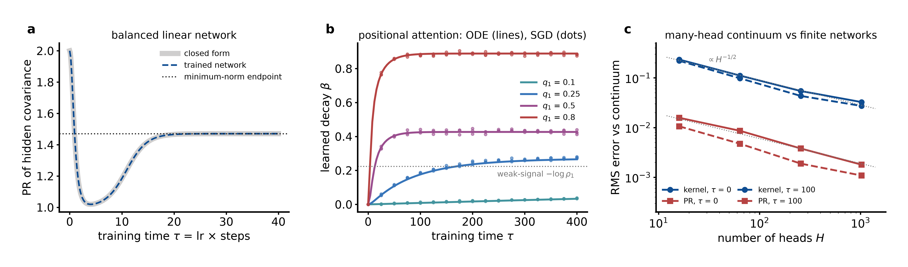
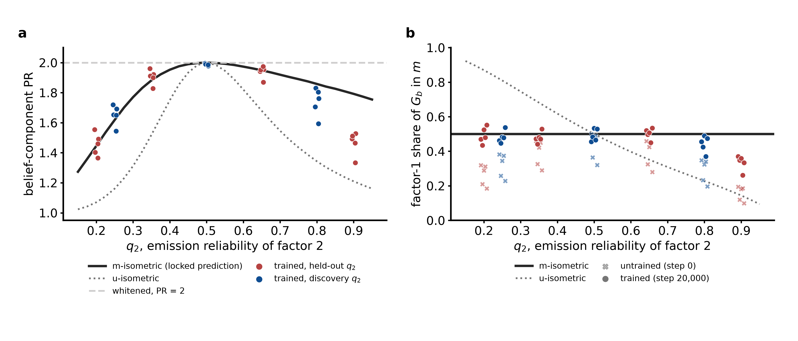
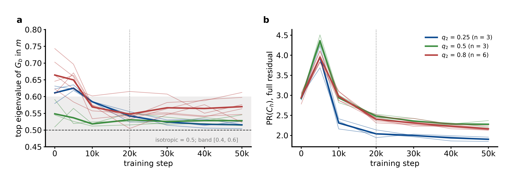
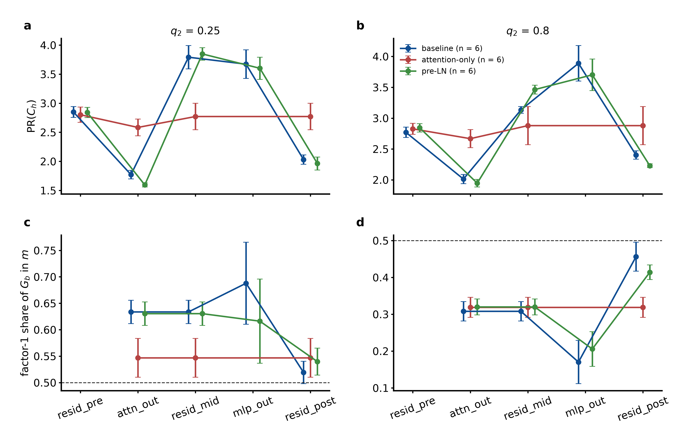

**Can the statistics of a sequence generator predict a small transformer's participation ratio?**

*A research note on belief geometry, learned encoding metrics, and what nine experiments on a two-factor hidden Markov generator do and do not establish. Results from the session of 15–16 November 2026.*

The project asks a narrow question. Train a transformer on sequences from a generator whose hidden-state posterior we can compute exactly, then measure the covariance of its residual stream at the final position. Can that covariance spectrum, summarized by its participation ratio, be predicted from the generator together with a stated theory of how the network encodes or learns, before the tested runs are trained? Decodability of beliefs from activations is already established for this kind of setup [1–3]. The target here is stronger: a nonconstant curve, fixed in advance, that survives held-out generator settings and fresh seeds.

The answer is partly yes, with a boundary at high reliability whose shape is not yet known. **Every exactly solvable layer of the theory was confirmed, usually to round-off or to the predicted scaling law: the belief statistics of the generator, the transport of belief covariance into activation covariance, balanced linear learning, a trained positional attention filter, and a many-head continuum limit. In the trained one-layer transformer, a generator-only rule, that the belief part of the representation is isometric in the posterior magnetizations $m$, predicted the seed-mean PR of the belief component within 2% at five of seven reliabilities (every run within 8%), including held-out $q_2=0.2$, the one held-out reliability where all three alternatives missed (by 26–38%). The same locked rule failed at the held-out high-reliability end ($q_2=0.9$: a 22% miss in the seed mean, and more than 10% in every seed), so its pre-registered verdict is not supported. The rule itself is an empirical regularity, chosen from earlier runs, that no learning calculation here derives.** The participation ratio of the full residual stream, which also carries token identity, was never predicted, may depend on the learning rate (one-seed pilots), and was still drifting after 50,000 steps.

The rest of the note sets up the generator and the observable, walks up the ladder of solvable models, then turns to the trained transformer and to what remains open. Each experiment's own write-up, with its pre-registered criteria, checks and run record, is linked where its result enters.

## The generator, its beliefs, and the observable

**The generator is a pair of independent binary hidden processes.** For each factor $a\in\lbrace 1,2\rbrace$ a hidden sign $`S^{(a)}_t`$ persists with probability set by $\rho_a$ and emits a noisy copy $`X^{(a)}_t`$ with reliability $q_a$,

```math
P(S_t=s\mid S_{t-1}=s')=\frac{1+\rho_a s s'}{2},
\qquad
P(X_t=x\mid S_t=s)=\frac{1+q_a x s}{2}.
```

The two emitted signs are packed into one of four tokens through a fixed arbitrary labelling, so the model sees a four-letter alphabet and has to discover the factor structure. Except in the restricted-attention and many-head studies, which state their own settings, $(\rho_1,q_1)=(0.8,0.5)$ and $\rho_2=0.8$, and the experiments sweep the second factor's reliability $q_2$. At $q_2=0.5$ the two factors are identical; away from it they differ in how informative their emissions are.

**The exact posterior is one number per factor.** The belief about factor $a$ after a context is its posterior magnetization $`m^{(a)}_t=\mathbb E[S^{(a)}_t\mid X^{(a)}_{1:t}]`$, which obeys a closed recursion: predict with $\rho_a m_{t-1}$, then update by Bayes' rule,

```math
m_t^{(a)}=\frac{\rho_a m_{t-1}^{(a)}+q_aX_t^{(a)}}{1+\rho_aq_aX_t^{(a)}m_{t-1}^{(a)}},
\qquad m_0^{(a)}=0,
\qquad
P(X_{t+1}^{(a)}=+1\mid c)=\frac{1+\rho_aq_am_t^{(a)}}{2}.
```

The second expression says what a predictor must know: the next token's distribution depends on the context only through $\rho_a q_a m_a$. Written as log-odds, the next-token logit for factor $a$ is

```math
u_a=\mathrm{atanh}(\rho_aq_am_a),
\qquad P(X_{T+1}^{(a)}=x\mid c)\propto e^{x u_a}.
```

So there are two natural coordinate systems for the same belief. The magnetization $m$ lives on the probability scale. The logit $u$ is what a linear unembedding followed by a softmax can read directly. They differ in two ways, which matter later: each factor's $u$ carries an extra gain $\rho_a q_a$, and the $\mathrm{atanh}$ stretches large $|m|$. For factor 1, $\rho_1 q_1=0.4$, so the stretch at $|m|=1$ is only $\mathrm{atanh}(0.4)/0.4=1.06$. For factor 2 at $q_2=0.9$, $\rho_2q_2=0.72$ and the stretch reaches $\mathrm{atanh}(0.72)/0.72=1.26$.

**The participation ratio counts equally used directions.** For the covariance $C$ of the final-position activation over contexts drawn from the generator,

```math
\mathrm{PR}(C)=\frac{(\mathrm{tr}\,C)^2}{\mathrm{tr}(C^2)}=\frac{\left(\sum_i\lambda_i\right)^2}{\sum_i\lambda_i^2}.
```

PR equals $k$ when $k$ eigenvalues are equal and the rest vanish, and interpolates otherwise. A spectrum $(1,0.25)$ gives $1.25^2/1.0625=1.47$: one strong direction and a weak one count as about one and a half.

**The belief covariance alone already predicts a nonconstant PR curve.** Independence and sign symmetry make the magnetization covariance diagonal, $\Sigma_m=\mathrm{diag}(v_1,v_2)$ with $v_a=\mathbb E[m_a^2]$, so

```math
\boxed{\mathrm{PR}_{\text{factored}}=\frac{(v_1+v_2)^2}{v_1^2+v_2^2}.}
```

A more reliable factor produces more confident posteriors, so $v_2$ grows with $q_2$. At context length $T=6$, $v_1=0.415$ while $v_2$ runs from 0.140 at $q_2=0.25$ to 0.737 at $q_2=0.8$, and the factored PR traces a curve that peaks at exactly 2 at $q_2=0.5$, where the factors are identical, and falls on either side. For $q_2=0.25$, $(0.4148+0.1399)^2/(0.4148^2+0.1399^2)=1.606$. The same beliefs written in the orthonormal four-state Walsh basis have centered coordinates $(m_1,m_2,m_1m_2)/2$, with variances $v_1/4$, $v_2/4$ and $v_1v_2/4$, and give a larger PR (1.925 at $q_2=0.25$). So "the belief PR" is not defined until we say which coordinates the network is supposed to use. That observation is the hinge of everything below.

**Activation covariance is belief covariance seen through an encoding metric.** If centered activations decompose as $h-\mu=Eb+\epsilon$ with $\epsilon$ uncorrelated with the belief coordinates $b$, then $C_h=E\Sigma_bE^\top+C_\epsilon$, and the belief part has

```math
\mathrm{PR}(E\Sigma_bE^\top)=\frac{[\mathrm{tr}(G\Sigma_b)]^2}{\mathrm{tr}(G\Sigma_bG\Sigma_b)},
\qquad G=E^\top E.
```

The metric $G$ is the unknown. An encoding that is isometric in $b$, meaning $G\propto I$, passes the belief PR through unchanged. An encoding isometric in $m$ therefore predicts the factored curve above, while one isometric in $u$ predicts the PR of $\mathrm{Cov}(u)$, which is much more lopsided because the gains $\rho_aq_a$ amplify whichever factor is more predictable. At $q_2=0.25$ (with $T=16$, the training context length) these are 1.619 and 1.162. A theory of the trained representation, at this level, is a theory of $G$.

## What each level of the theory claims, and what was tested

The [theory roadmap](../docs/theory_roadmap.md) organizes the calculation into levels of increasing ambition. The table maps each to the experiment that tests it and the outcome.

| Level | Claim | Experiment | Outcome |
| --- | --- | --- | --- |
| A, belief statistics | Exact belief covariance and PR from the generator | [Generator validation](../experiments/batch0-generator-validation/README.md) | Confirmed to round-off |
| B, specified encoding | $C_h=E\Sigma_bE^\top+C_\epsilon$; an isometric encoding preserves belief PR | Generator validation (imposed encodings) | Identity confirmed to $10^{-14}$ |
| C, solvable learning | Balanced linear learning follows a closed-form trajectory | [Balanced linear network](../experiments/batch1-balanced-linear/README.md) | Confirmed; fails only outside its assumptions |
| D, restricted attention | A trained positional decay follows its exact gradient-flow ODE | [Learned positional filter](../experiments/stagec-learned-filter/README.md) | Confirmed |
| E, many heads | A deterministic continuum predicts networks of $H$ heads with $H^{-1/2}$ error | [Many-head continuum](../experiments/heads-continuum/README.md) | Confirmed in the restricted model |
| B in a real transformer | The trained belief metric is isometric in $m$ (not $u$) | [Discovery](../experiments/transformer-discovery/README.md), [locked test](../experiments/transformer-confirm/README.md), [50k steps](../experiments/transformer-longrun/README.md) | Locked test not supported: within 2% (seed mean) at $q_2\le0.65$ and 7% at 0.8, fails at held-out 0.9 |
| Where geometry moves | Which block stage reshapes the covariance | [Ablations](../experiments/transformer-ablations/README.md), [six seeds](../experiments/transformer-ablations-seeds/README.md) | The MLP stage |

The first five rows are tests of mathematics in controlled models, where the theory is a derivation and the experiment checks it. The last two are tests of a hypothesis about a trained network, where the theory is an assumption about $G$ and the experiment can refute it.

## The solvable models agree with their predictions



**Figure 1.** (a) PR of the hidden covariance of a two-layer linear network trained on whitened belief coordinates with teacher $\mathrm{diag}(1,0.25)$ and aligned initialization at amplitude $10^{-3}$: the closed-form trajectory (grey band) and the trained network at the finest Euler step (dashed). (b) Learned positional decay $\beta$ for four values of factor-1 reliability: exact gradient-flow ODE computed from generator sums (lines) and minibatch SGD on sampled data, 3 seeds each (dots). (c) RMS error of restricted many-head networks with finite $H$ against their continuum solution, for the centered kernel matrix (blue) and for PR (red), at $\tau=0$ (solid) and $\tau=100$ (dashed); 16 seeds at $H\le64$, 8 at $H\ge256$. Nothing in any panel is fitted. Script: [`make_figures.py`](make_figures.py).

**The measurement pipeline reproduces the exact belief statistics.** Before any model was trained, two independent filters (the four-state matrix filter and the scalar recursion above) agreed on all 4,096 contexts of length 6 to below $10^{-15}$, the factored and joint PR tables matched the plan's printed values to six digits, sampled moments matched exact ones within sampling error, and every prescribed encoding produced $E\Sigma_bE^\top$ to $7\times10^{-15}$. The same validation checked the positional attention identity $C_h=\sum_{k\ell}B_k\Gamma_{k\ell}B_\ell^\top$ to $2\times10^{-15}$ and showed something worth remembering: dropping the temporal correlations between tokens, as an independent-token approximation would, changes the PR of an exponential attention kernel's output from 1.487 to 1.391. HMM tokens are correlated, and the covariance of anything that averages them inherits those correlations. The weak-signal expansion $m_T\approx q\sum_k\rho^kX_{T-k}$ was confirmed to have the predicted $O(q^4)$ error in the variance, and it is already 12.7% off at $q=0.2$ with $\rho=0.8$, so it is a short-range tool. None of this says anything about transformers; it certifies the ruler.

**Balanced linear learning predicts the whole PR trajectory, including a dip.** For a two-layer linear network $\hat y=DEz$ on whitened inputs with teacher singular values $s_i$, balanced mode-aligned gradient flow gives each hidden eigenvalue its own logistic equation,

```math
\dot a_i=2a_i(s_i-a_i),
\qquad
a_i(\tau)=\frac{s_i}{1+\left[s_i/a_i(0)-1\right]e^{-2s_i\tau}},
\qquad
\mathrm{PR}(\tau)=\frac{\left[\sum_ia_i(\tau)\right]^2}{\sum_ia_i(\tau)^2}.
```

The strong mode's growth rate $2s_1$ is four times the weak mode's, so it saturates first. While only the strong mode is learned, the hidden covariance is nearly rank one and PR drops from 2 toward 1. When the weak mode catches up, PR rises again to the endpoint $(\sum s_i)^2/\sum s_i^2=1.4706$. Figure 1a shows the trained network following this nonmonotone path with no fitted quantity. The intuition generalizes: during learning, PR measures how many modes have been learned so far, weighted by their size, and not a fixed property of the task. The maximum eigenvalue error halved with each halving of the Euler step (0.061, 0.030, 0.015, 0.0076), which is first-order convergence to the continuous-time prediction. Balanced or small initializations ended within 0.02% of the predicted endpoint. A deliberately imbalanced initialization ended at PR up to 1.72, 17% off, because the conserved imbalance $\lVert EE^\top-D^\top D\rVert_F$ leaves extra covariance in the hidden layer. That places such runs outside the theorem's assumptions rather than refuting it, and it is a reminder that Adam and cross-entropy, which the transformer uses, are not covered by this theorem either.

**A trained attention decay follows its exact learning equation.** The restricted attention model computes a softmax-weighted positional average of fixed token features with one trainable decay $\beta$ and a linear readout,

```math
z(c;\beta)=\sum_{k=0}^{T-1}\mathrm{softmax}_k(-\beta k)\,\phi(x_{T-k}),
\qquad f=w^\top z,
```

and is trained to predict factor 1's next sign. Integrating the gradient-flow ODE for $(w,\beta)$ with the loss evaluated as an exact sum over all 4,096 contexts gives a prediction that uses nothing from the SGD runs. At $\tau=400$ it predicts $\beta=0.427$ and 0.888 for $q_1=0.5$ and 0.8, against $0.425\pm0.014$ and $0.881\pm0.006$ for SGD (3 seeds), and the PR of the attention statistic's covariance to within an evaluation-sample offset of about 0.004 (Figure 1b). At low reliability SGD sat 4–8% above the ODE; halving the learning rate shrank that excess from 8.2% to 3.3% at $q_1=0.1$ and from 3.8% to 0.6% at $q_1=0.25$, so most of it was a finite-step effect of SGD. The intuition for the result is the filter itself. When emissions are reliable, each new token nearly resets the posterior, so the optimal statistic forgets quickly, and the learned decay is 0.89 at $q_1=0.8$, four times the weak-signal value $-\log\rho_1=0.22$. When emissions are noisy, evidence must be pooled over many tokens and the decay stays small. The learned attention kernel is a property of the generator, and the ODE gets it right.

**A many-head continuum predicts finite networks, with the error a central limit theorem would give.** The bridge to wide-network theory is an exact identity. With the population-centered feature kernel $k(c,c')=\tfrac1d(h_c-\mu)^\top(h_{c'}-\mu)$,

```math
\mathrm{PR}(C)=\frac{\left(\mathbb E_c[k(c,c)]\right)^2}{\mathbb E_{c,c'}[k(c,c')^2]},
```

so predicting the learned kernel closes the PR calculation without ever predicting individual weights. In the restricted many-head model of the derivations (content-plus-position attention per head, a residual tanh MLP, mean readout over $H$ heads, length-3 contexts so the population objective is an exact sum over 64 contexts), the $H\to\infty$ limit is a deterministic flow of a distribution over head parameters, solved by cubature. Finite networks draw $H$ heads from the same initial law. Each head is one sample, so a finite network is a Monte Carlo estimate of the continuum and its error should shrink as $H^{-1/2}$. Figure 1c is consistent with that: fitted exponents of $-0.48$ to $-0.51$ for the kernel and $-0.53$ to $-0.56$ for PR over $H=16$ to 1,024 (seed-bootstrap intervals of about $\pm0.12$ and $\pm0.14$), though the kernel slope between $H=256$ and 1,024 alone is shallower, $-0.34$ to $-0.37$. The linearized fluctuation formula predicts the seed-to-seed spread of PR at initialization to within 2% for $H\ge64$ against 2,000 draws per $H$, and the onset coefficients reproduce the derivations' table to twelve digits. Training lowers PR from 2.0443 to 2.0232 by $\tau=100$, twenty times the RMS finite-network error at $H=1{,}024$, and freezing the attention parameters leaves PR within 0.001 of its initial value. So in this model the geometry change is carried by attention learning, and the continuum predicts it.

**One continuum result is a caution about reading PR.** Adding an interaction logit $y_1y_2f_{12}$ that lets the model represent dependence between the factors raised the residual PR in every case, including on an exactly independent generator (2.094 against 2.045), where there is nothing to represent. On a coupled generator with mixing $\varepsilon=0.2$ the interaction model did learn real interaction content, ending with excess loss 0.00099 nats below the factorization gap of 0.00228 that no factorized predictor can beat. A higher PR is therefore not evidence of new content; it can come from how an extra gradient reshapes shared parameters.

**What these five checks establish.** The generator-side mathematics is exact, the belief-to-activation identity is exact, and three learning theories (linear balanced, restricted positional attention, restricted many-head) predict their models' representation spectra with nothing fitted: from the teacher's singular values for the linear network, and from the generator for the other two. None of them is a dense transformer trained with Adam and cross-entropy, and the restricted many-head model has fixed value features and no cross-head mixing. Whether any of these mechanisms survives in the real architecture is the question the next section takes up.

## The trained transformer: a locked prediction that holds, then breaks

The model is a one-layer decoder-only transformer with width 64, two heads of width 32, a GELU MLP of width 256, learned embeddings and no normalization, trained online with Adam at learning rate $10^{-3}$, batch 256, for 20,000 steps on fresh length-16 contexts. Every number is at the final position of the residual stream after the layer, on 65,536 held-out contexts.

**The measured object is a token-partialled belief metric.** The final-position activation contains the last token's embedding, and token identity alone explains 54–72% of the trained activation variance. Regressing $h$ on beliefs alone would credit some of that to the beliefs, because the last token is correlated with them. So each analysis fits

```math
h\approx c+E\,[\,b,\ \mathrm{onehot}(x_T)\,],
```

on half the contexts and evaluates on the other half, and keeps the two columns $E_b$ that multiply $b$. Those columns measure what the network encodes about the belief beyond the identity of the last token. The trace-normalized metric $G_b=E_b^\top E_b/\mathrm{tr}(E_b^\top E_b)$ has two eigenvalues summing to 1, an encoding isometric in $b$ gives $(0.5,0.5)$, and its factor-1 share $`(G_b)_{11}`$ says how the encoding splits its gain between the factors. The observed belief PR is $\mathrm{PR}(E_b\Sigma_bE_b^\top)$, and the prediction error is $e_{\mathrm{PR}}=\lvert\text{predicted}-\text{observed}\rvert/\text{observed}$. For one run at $q_2=0.25$, $G_b$ had eigenvalues $(0.524,0.476)$ in $m$ and $(0.796,0.204)$ in $u$, and its belief PR was 1.575 against 1.619 for an $m$-isometric encoding ($e_{\mathrm{PR}}=0.028$) and 1.162 for a $u$-isometric one ($e_{\mathrm{PR}}=0.26$).

**Discovery: the encoding is much closer to isometric in $m$ than in $u$, and clearly not isometric in $u$.** In the first transformer experiment (three seeds at each of $q_2\in\lbrace0.25,0.5,0.8\rbrace$), the top eigenvalue of $G_b$ was 0.52–0.62 in $m$ against 0.68–0.80 in $u$ in all six anisotropic runs, and the $m$-isometric PR matched the belief PR within 7% in eight of nine runs. Isometry in $u$ was rejected outright. Isometry in $m$ was graded inconclusive because one $q_2=0.8$ seed sat at 0.615, just outside the pre-set band $[0.4,0.6]$; under the definition's original prediction-quality bar that seed would have been excluded and the verdict would have read supported. The bar was changed after training and before grading, for a stated noise reason that holds against the logs, and the [discovery write-up](../experiments/transformer-discovery/README.md) reports both verdicts. Training added a large belief component beyond token identity (held-out $R^2$ gain 0.24–0.45, against 0.002–0.005 at initialization), so the metric describes learned structure. The preference for $m$ over $u$ was already present in all six untrained anisotropic runs, where the belief signal is almost nil, and training widened it at $q_2=0.8$.

**The locked test: m-isometry was frozen as a prediction and tested on held-out reliabilities.** Before launch, the prediction curve, the grading script and the criteria were committed, and four reliabilities that no model had seen ($q_2=0.2,0.35,0.65,0.9$) were added to the three discovery ones, with five new seeds each. The headline criterion asked the $m$-isometric curve to predict the held-out belief PR within 10% while all three alternatives (whitened, PR = 2; $u$-isometric; each run's own untrained value) failed.



**Figure 2.** (a) Belief-component PR at step 20,000, one point per run (5 seeds per $q_2$, 35 runs, all passing the prediction-quality bar), with the generator-only curves for an encoding isometric in $m$ (the locked prediction), isometric in $u$, and whitened. Red points are held-out reliabilities. (b) Factor-1 share of the token-partialled metric $G_b$ in $m$, trained (circles) and untrained (crosses), against the $m$-isometric value 0.5 and the share an encoding isometric in $u$ would show when measured in $m$ (dotted; computed from the generator alone, see below). Data: [`transformer-confirm/results.json`](../experiments/transformer-confirm/results.json); reference curves: [`figures/fig1_reference_curves.json`](figures/fig1_reference_curves.json).

| $q_2$ | held out | $m$-isometric PR | observed, mean ± SD | $e_{\mathrm{PR}}$, $m$ | $e_{\mathrm{PR}}$, whitened | $e_{\mathrm{PR}}$, $u$ | $e_{\mathrm{PR}}$, untrained | top eig. of $G_b$ |
|---|---|---|---|---|---|---|---|---|
| 0.2 | yes | 1.443 | 1.455 ± 0.074 | **0.008** | 0.375 | 0.265 | 0.261 | 0.555 |
| 0.25 | no | 1.619 | 1.652 ± 0.067 | **0.020** | 0.211 | 0.297 | 0.128 | 0.545 |
| 0.35 | yes | 1.880 | 1.905 ± 0.048 | **0.013** | 0.050 | 0.204 | 0.008 | 0.543 |
| 0.5 | no | 2.000 | 1.985 ± 0.008 | **0.007** | 0.007 | 0.007 | 0.064 | 0.542 |
| 0.65 | yes | 1.947 | 1.938 ± 0.040 | **0.005** | 0.032 | 0.135 | 0.128 | 0.532 |
| 0.8 | no | 1.855 | 1.739 ± 0.094 | **0.066** | 0.150 | 0.229 | 0.188 | 0.565 |
| 0.9 | yes | 1.791 | 1.466 ± 0.078 | **0.222** | 0.364 | 0.175 | 0.199 | 0.668 |

Seed means over 5 runs; $e_{\mathrm{PR}}$ uses the seed-mean prediction and observation, and values of 0.1 or more fail. Source: [`grade.json`](../experiments/transformer-confirm/grade.json) and [`extras.json`](../experiments/transformer-confirm/extras.json).

**The prediction holds over most of the range and fails at the high end.** From $q_2=0.2$ to 0.65 the locked curve predicts the seed-mean belief PR within 2%, and at held-out $q_2=0.2$ it passes (0.008) while all three alternatives miss by 26–38%. That is the discriminating case the experiment was designed around: a generator-only curve, fixed before training, distinguishing among hypotheses at a reliability no model had been trained on. At $q_2=0.8$ the miss grows to 7%. At held-out $q_2=0.9$ the prediction is 22% too high, every one of five seeds misses by more than 10% (0.17–0.34), and the metric's top eigenvalue is 0.668, outside the band in all five. Under the pre-set rules, that one reliability makes the PR prediction not supported on both the held-out and the full scope, and the headline criterion not met. The isotropy-band prediction was likewise not supported, on $q_2=0.9$ alone. All 35 runs finished and passed both validity gates, so this is a clean negative, not a failed run. Two weaker predictions were supported: training moved the metric toward isotropy in 34 of 35 runs, and the metric was closer to isotropy in $m$ than in $u$ in 29 of 30 anisotropic runs (against 17 of 30 before training).

**At high reliability the network gives the more predictable factor extra gain.** Figure 2b shows how the miss happens. At low and middle reliabilities the trained factor-1 share sits at 0.48–0.50, so both factors get equal gain in $m$ units. At $q_2=0.8$ and 0.9, where factor 2's belief variance is largest ($v_2=0.74$ and 0.85 against $v_1\approx0.42$), its share of the gain grows (factor-1 share 0.443 and 0.334). That makes the belief component more lopsided than $m$-isometry allows and drags the PR toward the $u$-isometric curve, which distorts in the same direction. On a scale where $u$-isometric is 0 and $m$-isometric is 1, the observed PR sits at 1.03, 1.07, 1.07, 0.97, 0.78 and 0.44 for $q_2=0.2$, 0.25, 0.35, 0.65, 0.8 and 0.9 (this scale was computed after grading and is exploratory). Generator anisotropy alone does not explain it, because $q_2=0.2$ is also strongly anisotropic ($v_2/v_1=0.23$, against 2.04 at $q_2=0.9$) with the roles reversed, and there the prediction holds within 1%.

**What a u-isometric encoding looks like when measured in m.** The dotted curve in Figure 2b is computed from the generator alone, and it is exact under the $u$-isometry hypothesis. If $h=c+E_uu+(\text{token terms})$ with $E_u^\top E_u\propto I$, then by linearity of least squares the regression of $h$ on $[m,\mathrm{onehot}(x_T)]$ returns $E_m=E_uB$, where $B$ is the $2\times2$ block of coefficients on $m$ from regressing $u$ itself on $[m,\mathrm{onehot}(x_T)]$. Hence

```math
G_b(m)\propto B^\top B,
\qquad
\text{factor-1 share under }u\text{-isometry}=\frac{(B^\top B)_{11}}{\mathrm{tr}(B^\top B)},
```

which we estimate by Monte Carlo on 200,000 contexts per $q_2$. It runs from 0.87 at $q_2=0.2$ to 0.14 at $q_2=0.9$, crossing 0.5 at $q_2=0.5$. As a consistency check, the discovery experiment measured the reverse direction: its encodings, near-isometric in $m$, showed a $u$-metric top eigenvalue of about 0.79 at $q_2=0.25$, close to the reference's 0.81. The trained points ignore this curve at low $q_2$ and move toward it at high $q_2$.

**The untrained metric makes the high-reliability miss ambiguous.** Before training, the factor-1 share is below 0.5 at every reliability (seed means 0.16–0.43), including the symmetric $q_2=0.5$, so the random initialization already favours factor 2 by an amount whose cause was not examined. These untrained shares rest on almost no signal: at step 0 the belief block adds only 0.002–0.005 held-out $R^2$ beyond the last token, below the 0.01 gate under which the ablation study treats the metric as undefined, and the argument below is weaker for it. At $q_2=0.9$ the untrained share (0.156) happens to sit on the $u$-isometric curve (0.144), so the trained value of 0.334 is consistent with two different stories: a pull toward the logit coordinates that grows with the $\mathrm{atanh}$ stretch, or an incomplete departure from where training started. The low end weakly favours the first, since at $q_2=0.2$ training moved the share from 0.263 all the way to 0.492 even though it started further from 0.5 than at $q_2=0.8$, where it stopped at 0.443. One reading consistent with both ends is that the initial bias toward factor 2 and a pull toward $u$ oppose each other at low $q_2$, where $u$-isometry would favour factor 1, and add at high $q_2$, where both favour factor 2. This was noticed after looking at the data and has not been tested. A cheap experiment separates the two: vary $q_1$ instead of $q_2$, so the reliable factor is factor 1. A pull toward $u$ would then push the share above 0.5, while a leftover initialization bias would keep it below.

**Longer training stabilizes the metric where the prediction holds, and leaves the high end wandering.** A follow-on trained 12 runs to 50,000 steps at $q_2\in\lbrace0.25,0.5,0.8\rbrace$, reusing the discovery seeds and adding three at 0.8.



**Figure 3.** (a) Top eigenvalue of the token-partialled metric $G_b$ in $m$ against training step; thin lines are individual runs and thick lines seed means, with the isotropy band shaded. (b) PR of the full 64-dimensional residual covariance $C_h$. The dotted vertical line marks 20,000 steps, where the other experiments stop. Data: [`transformer-longrun/stability.json`](../experiments/transformer-longrun/stability.json).

At $q_2=0.25$ and 0.5 the metric settled (at 0.25 it moved slightly closer to isotropy), and by 50,000 steps the belief PR matched the $m$-isometric prediction within 1% in every run (ratios 0.992–1.001). The pre-registered stability verdict was met: 11 of 12 runs in the band, $m$ closer than $u$ in 9 of 9 anisotropic runs, and a median absolute change of the top eigenvalue of 0.019 between 20,000 and 50,000 steps. At $q_2=0.8$ individual seeds kept moving by up to 0.07, two of them rising steadily from 0.53–0.54 to 0.60–0.61, and the belief PR stayed below the prediction in all six (ratio 0.880–0.978, mean 0.93). So the high-reliability shortfall at 0.8 did not shrink with 2.5 times more training, which argues against "undertrained" as the explanation there. The stability criteria were defined for this follow-on and are looser than the discovery experiment's every-run rule, which still fails at 50,000 steps, now on two $q_2=0.8$ runs ($e_{\mathrm{PR}}$ 0.136 and 0.113) instead of one. The $q_2=0.9$ seeds were not run to 50,000 steps.

**The full residual PR was not predicted and has not settled.** Figure 3b shows the representation's whole covariance rising from about 2.9 at initialization to a peak of 3.7–4.5 around 5,000 steps, then falling. It fell by a median 9.1% between 20,000 and 50,000 steps and was still falling by 2.7% over the last 10,000. The ablation study's learning-rate pilots hint at another dependence: at similar prediction quality (final KL 0.00052 against 0.00059), PR($C_h$) at $q_2=0.5$ was 4.00 at learning rate $3\times10^{-4}$ and 2.37 at $10^{-3}$ (one seed each). Across reliabilities in the locked test, PR($C_h$) rose from 1.82 at $q_2=0.2$ to about 2.4 at 0.35 and stayed flat within seed spread up to 0.9, with no peak at 0.5. The full covariance mixes the belief block with a token-identity block and with residual activity, as the roadmap's warning that $\mathrm{tr}(C_h^2)$ contains a cross term $2\mathrm{tr}(C_{\mathrm{bel}}C_\epsilon)$ anticipated, and no theory here addresses that mixture. Any PR law for $C_h$ would have to name its training step and optimizer settings.

## Where in the block the geometry changes



**Figure 4.** PR of the activation covariance (a, b) and factor-1 share of the token-partialled belief metric in $m$ (c, d) at each position in the one-layer block, at step 20,000, as mean ± sample SD over six seeds. `resid_pre` is the embedding, `attn_out` the attention output, `resid_mid` the residual after attention, `mlp_out` the MLP output and `resid_post` the residual after the MLP, which the readout sees. The belief metric is shown only where beliefs add at least 0.01 held-out $R^2$ beyond the last token, so it is absent at the embedding. The attention-only model has no MLP and misses the prediction-quality bar at $q_2=0.8$ in all six seeds, so its panel-b and panel-d points are not graded. Data: [`transformer-ablations-seeds/results_combined.json`](../experiments/transformer-ablations-seeds/results_combined.json).

**Attention writes the belief block and the MLP reshapes it.** Comparing three architectures (baseline, attention-only, and pre-LayerNorm on branch inputs only) across six seeds and two reliabilities, the stage that moves the final-position geometry is the MLP. In the baseline, PR($C_h$) falls across the MLP stage from $3.79\pm0.20$ to $2.03\pm0.08$ at $q_2=0.25$ and from $3.13\pm0.05$ to $2.40\pm0.07$ at $q_2=0.8$, more than four times the pre-registered threshold in both conditions. The MLP also moves the belief metric's factor-1 share, from 0.308 to 0.456 at $q_2=0.8$ and from 0.634 to 0.519 at $q_2=0.25$, in opposite directions and in each case toward 0.5. Attention's own belief block, by contrast, passes through the residual add unchanged once token identity is partialled out (agreement to about $10^{-9}$ between `attn_out` and `resid_mid`, which is a built-in check of the analysis), and LayerNorm before the MLP changes its factor-1 share by at most 0.021 (six seeds). Pre-LayerNorm changes the belief metric by at most 0.042 and lowers PR($C_h$) by 7% at $q_2=0.8$ only. All eight of the pre-registered verdicts held when the original three seeds were extended to six.

**A plausible mechanism for the MLP's effect, found after looking.** Across the MLP stage the trace of $C_h$ drops from 42.1 to 16.2 at $q_2=0.25$ (six seeds) while the held-out $R^2$ of the activation on $m$ alone rises from 0.51 to 0.875, so the variance that beliefs do not explain falls from about 21 to 2. One reading is that the MLP output cancels most of the residual's non-belief variance, along with part of the belief variance, and leaves the covariance concentrated in fewer directions. This came from one exploratory pass over the results and was not tested. It does fit a broader picture: in the factor-share panels, the MLP is also the stage that brings the two factors' gains toward equality, which is what $m$-isometry describes. If so, the $m$-isometry regularity is a property of what the MLP does to attention's output, and a theory of it has to be a theory of that stage.

The attention-only model does not fit the simple story, because its residual is already small (trace 15.6 at $q_2=0.25$) yet its PR stays higher than the baseline's (2.77 against 2.03), so attention trained without an MLP downstream writes a differently shaped residual. It also predicts about twice as far from Bayes as the baseline at $q_2=0.25$ and fails the prediction bar at $q_2=0.8$, which limits what that comparison can say.

## What is established, what is not, and why

**Established, as derivations confirmed numerically:**

- The belief covariance and its PR in factored and joint coordinates, the transport identity $C_h=E\Sigma_bE^\top+C_\epsilon$, and the positional attention covariance identity, each to round-off.
- The balanced linear PR trajectory, nonmonotone dip included, within its assumptions, with a measured failure when balance is broken.
- The learned positional decay and its PR from an exact ODE, with most of SGD's low-reliability gap traced to discretization.
- The many-head continuum's prediction of finite networks with $H^{-1/2}$ error, and the initialization fluctuation formula within 2%, in the restricted model.

**Established, as empirical findings in the one-layer transformer at this scale:**

- The token-partialled belief metric is much closer to isometric in $m$ than in $u$ (29 of 30 anisotropic runs in the locked test; 9 of 9 at 50,000 steps).
- A generator-only $m$-isometric curve, chosen from the discovery runs and locked before the test, predicts the seed-mean belief-component PR within 2% at the five reliabilities from $q_2=0.2$ to 0.65 (a range read off after grading; the pre-registered verdict over all seven is not supported), and beats all three alternatives at held-out $q_2=0.2$.
- The same prediction fails at held-out $q_2=0.9$ (22% in the seed mean, 17–34% per seed), with the network giving the more predictable factor extra gain.
- After attention writes the belief block, the MLP stage is where the final-position covariance and the belief metric's factor-1 share change. The residual add leaves the partialled belief block unchanged, LayerNorm before the MLP moves the share by at most 0.021, and LayerNorm's effect on PR($C_h$) is inconclusive.

**Not established:**

- Any derivation of $m$-isometry from a learning rule. It is a Level B hypothesis (an encoding metric specified independently of the tested runs), not a consequence of Levels C–E, and the three solvable models above are not the transformer. Why gradient descent with cross-entropy should equalize gains in probability units rather than in logit units is open.
- Whether the $q_2=0.9$ departure is a stable crossover toward $u$, an initialization residue, or a transient. The $q_2=0.8$ evidence at 50,000 steps argues against a pure transient there; $q_2=0.9$ itself was not trained longer.
- Any prediction of the full residual PR. It mixes the belief block with a large token-identity component (the last token's one-hot alone explains 54–72% of the variance), differed by a factor of 1.7 between two learning rates in one-seed pilots, and was still falling at 50,000 steps.
- Transfer to deeper or wider models, to a pre-LN model with a final LayerNorm, or to other generators (Mess3 and matched-statistics pairs were not implemented).

**Why the regularity might be $m$ and not $u$, as a hypothesis.** Attention produces convex combinations of value vectors weighted by position, and in the weak-signal regime the belief itself is such a combination, $m_T\approx q\sum_k\rho^kX_{T-k}$. A representation built from positional averages of token embeddings is therefore naturally linear in something like $m$, with gains set by the embedding geometry rather than by each factor's predictive value. Reading out the logit then only needs the unembedding to scale each factor by $\rho_aq_a$, which is free for a linear map, plus the $\mathrm{atanh}$ curvature, which is not. That curvature is negligible for factor 1 (a 6% stretch at most) and grows for a highly reliable factor (26% at $q_2=0.9$), which is where the measured encoding starts to bend toward $u$. This picture accounts for the qualitative pattern, including why the departure appears only at the high end, but it does not explain why training lands on equal gains specifically, and the untrained bias toward factor 2 complicates it at $q_2=0.9$. It is an intuition to test, not a result.

## Next calculations

The most informative next experiment is cheap. Train the five $q_2=0.9$ seeds to 50,000 steps, add $q_2=0.85$ and 0.95, and run the factor-swapped design (vary $q_1$ with $q_2=0.5$) at the same reliabilities. At the observed pace they would take roughly two dollars of A40 time and would decide whether the high-reliability departure grows smoothly with the readout's curvature, follows the reliable factor's identity, or follows the initialization's bias. That determines whether a theory of $G$ needs a crossover term.

On the theory side, the open step is a learning calculation that outputs $G$ for a model containing an MLP, since the ablations place the geometry change there. Two routes look feasible. The roadmap's local quadratic expansion of cross-entropy (§5.3), with an explicit Fisher weighting, would predict which coordinates a near-optimal network equalizes and where $m$ and $u$ part ways. Alternatively, the restricted many-head continuum, which already predicts finite networks well, could be extended with trainable value features and checked against the dense transformer's factor shares at a few reliabilities. A successful calculation would predict Figure 2b, including the bend at high $q_2$, before it is measured.

## How far to trust these numbers

Every GPU experiment was defined before it ran, with criteria fixed in an `EXPERIMENT.md` and a grading script written before the graded quantities were read; deviations, such as the discovery experiment's amended prediction-quality bar, are recorded in each write-up's "Judgement calls". Every experiment write-up went through an independent fact-check against its result files, logs and git history, except three sections added to the CPU write-ups afterwards (the learned filter's learning-rate check and the continuum study's coupled-generator and fluctuation sections). The checks corrected rounding, scope and framing errors (14 of about 128 claims across the four CPU write-ups, 6 to 13 per GPU write-up) and changed no verdict; the largest change softened the discovery headline from "encodes close to isometrically in $m$" to match its inconclusive grade. The five GPU experiments ran on single A40s for about \$3.64 in total. Seeds per condition are 3 to 6. That is enough to clear the ablations' pre-registered $2\cdot\mathrm{SD}$ rules, but the discovery verdict turned on one seed of three, and it is not enough to estimate tails. This note was fact-checked the same way: of about 190 claims, about 20 were corrected, mostly scope (seed-mean against per-seed numbers, mixed seed sets, a range chosen after grading) plus four outright errors (a per-seed claim that held only for the seed mean, the parameter settings of two studies, the inputs of the linear model, and the share of variance carried by token identity). The analysis was graded only at the final position after the layer; the other sites are recorded in the result files but were not examined beyond the ablations.

This note adds one new quantity, the factor-1 share expected under $u$-isometry (Figure 2b's dotted curve), and the reading of the untrained shares built on it. Both were computed after the experiments were graded and are exploratory. The figures here are redrawn from the committed result files by [`make_figures.py`](make_figures.py) (`uv run python writeup/make_figures.py`); each experiment's folder also has its original figures.

## References and reading guide

1. A. S. Shai, S. E. Marzen, L. Teixeira, A. Gietelink Oldenziel, P. M. Riechers. *Transformers Represent Belief State Geometry in their Residual Stream* (NeurIPS 2024). [arXiv:2405.15943](https://arxiv.org/abs/2405.15943). The precedent for decodable belief geometry in HMM-trained transformers.
2. M. Piotrowski, P. M. Riechers, D. Filan, A. Shai. *Constrained Belief Updates Explain Geometric Structures in Transformer Representations* (ICML 2025). [PMLR](https://proceedings.mlr.press/v267/piotrowski25a.html). Architecture-dependent belief updates in attention; the closest precedent for a restricted-attention calculation.
3. A. Shai et al. *Transformers learn factored representations* (ICML 2026). [PMLR](https://proceedings.mlr.press/v306/shai26a.html). Factored activation spectra; the closest comparison for the two-factor setup.
4. A. M. Saxe, J. L. McClelland, S. Ganguli. *Exact solutions to the nonlinear dynamics of learning in deep linear neural networks* (ICLR 2014). [arXiv:1312.6120](https://arxiv.org/abs/1312.6120). The mode dynamics behind Figure 1a.
5. B. Bordelon, H. T. Chaudhry, C. Pehlevan. *Infinite Limits of Multi-head Transformer Dynamics* (NeurIPS 2024). [arXiv:2405.15712](https://arxiv.org/abs/2405.15712). The many-head limit that the restricted continuum specializes.

Project documents: the [theory roadmap](../docs/theory_roadmap.md) states each level briefly, the [derivations](../docs/derivations.md) prove them and fix the notation, and the [experiment plan](../docs/experiment_plan.md) turns them into staged tests. The [experiment log](../EXPERIMENTS.md) lists every GPU run with hardware, runtime and cost.
